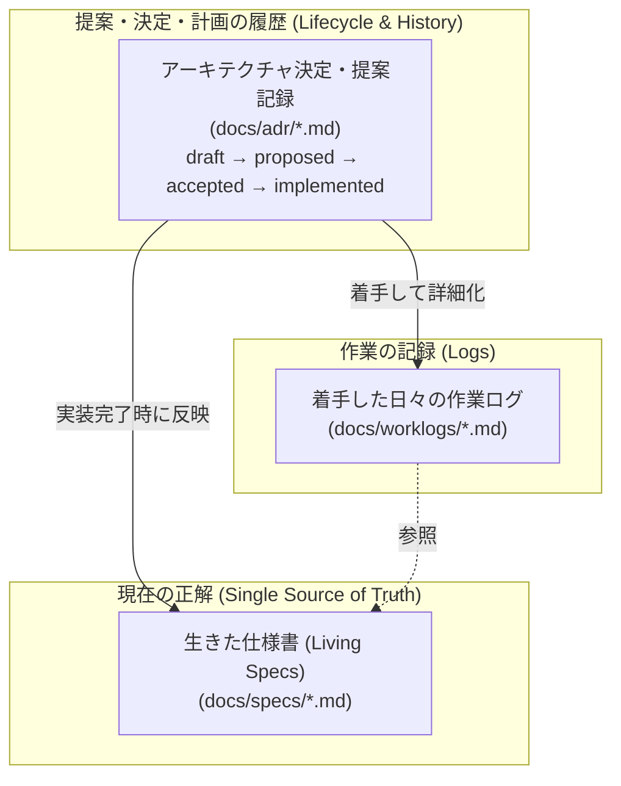

# Vy ドキュメント案内

Vy の設計・開発ドキュメントへようこそ。このディレクトリ配下の文書は、目的とライフサイクルに応じて以下の 3 つの役割に分かれています。



---

## 1. 3 つの役割の見分け方

置き場所は「ドキュメントの性質と目的」で分類します。

| 種類         | 定義                                             | 書くもの                                             | 書かないもの                           |
| :----------- | :----------------------------------------------- | :--------------------------------------------------- | :------------------------------------- |
| **specs**    | 現在のコードベースの規範 (SSOT)                  | 現行仕様（表、上限値、プロトコル、API 一覧）         | 決定の歴史、未実装の予定（注記のみ可） |
| **ADR**      | アイデア起草・提案・アーキテクチャ決定・実装計画 | 文脈、動機、代替案、方針決定、実装タスク、見直し条件 | 着手した日々の作業ログ、実測値         |
| **worklogs** | 着手した日々の作業記録                           | 日付、実測値、つまずき、試行錯誤、移行手順           | 決定そのもの                           |

### 判定の基準

1. **いまシステムがどう動いているか、外部に公開する仕様は何か** → `specs/`
2. **設計の提案、アーキテクチャの決定、未着手の機能計画やロードマップ** → `adr/`（ステータス: `draft` / `proposed` / `accepted` / `implemented`）
3. **着手した作業の日付入り記録・実測値・ログ** → `worklogs/`

### よくある混ざり方と正しい置き場所

| アンチパターン                                     | 正しい置き場所                                             |
| :------------------------------------------------- | :--------------------------------------------------------- |
| ADR に日付入りの作業ログ・詳細なエラーログ・実測値 | worklogs                                                   |
| ADR に確定仕様の巨大な一覧表・プロトコル詳細       | 概要は ADR に書き、確定規範は specs へ反映する             |
| specs に未実装の計画を確定仕様として書く           | 実装状況を明記するか、ADR（`proposed` / `accepted`）に置く |

### 置き換えられた ADR

決定を置き換えたときは、古い ADR を [`adr/superseded/`](./adr/superseded/README.md) へ移します。番号は変えません。現行の索引（[`adr/README.md`](./adr/README.md)）には置き換え済みを含めません。

---

## 2. どこに何があるか

### ① 開発ガイド・方針

- [`development.md`](./development.md): 開発環境、言語ルール、テスト・ビルド・検証の手順。

### ② 生きた仕様書 (Living Specs)

「いまシステムがどう設計・実装されているか」の唯一の正解（SSOT）です。常に最新の状態にメンテナンスされます。一覧は [`specs/`](./specs/README.md) にあります。

- [`specs/architecture.md`](./specs/architecture.md): 全体アーキテクチャ、プロセスモデル、状態の所在。
- [`specs/protocol.md`](./specs/protocol.md): クライアント・コア間の RPC 通信プロトコル仕様。
- [`specs/api.md`](./specs/api.md): プラグイン・設定に公開する API 一覧と仕様。
- [`specs/plugin-system.md`](./specs/plugin-system.md): プラグインの構造、読み込み、実行サンドボックス。
- [`specs/ui.md`](./specs/ui.md): プラグイン UI ウィジェット、描画モデル。
- [`specs/panes.md`](./specs/panes.md): ペイン分割、レイアウトツリー。
- [`specs/commands.md`](./specs/commands.md): コマンドパレット、Ex コマンドライン、キーバインド。
- [`specs/keymap.md`](./specs/keymap.md): モードごとのキーマップ一覧と実装状況。
- [`specs/layout.md`](./specs/layout.md): ディレクトリ構成、設定ファイル・キャッシュの配置場所。

### ③ アーキテクチャ決定・提案記録 (ADR)

- [`adr/`](./adr/README.md): アイデアの提案から意思決定、実装完了までをステータスで一元管理する記録です。ロードマップ、アーキテクチャ設計、機能仕様、保守計画が含まれます。一度採択された ADR は決定内容を書き換えず、方針を変える際は新しい ADR を追加します。置き換え済みの ADR は [`adr/superseded/`](./adr/superseded/README.md) に移します。

### ④ 作業ログ (Worklogs)

- [`worklogs/`](./worklogs/README.md): **着手した**リファクタリング、移行作業、性能改善などの計画と実施ログ（日付、実測値、つまずき）を記録します。

---

## 3. メタデータ (frontmatter) 規約

ドキュメントの検索性・機械可読性を保つため、すべての Markdown ドキュメントの先頭には YAML frontmatter を配置します。

```yaml
---
title: "ドキュメントタイトル"
type: "spec" # "spec" | "adr" | "worklog" | "guide"
updated_at: 2026-10-27
---
```

各ドキュメント種別ごとの拡張項目（`status`, `category`, `related_adrs`, `supersedes` 等）の詳細は [`development.md`](./development.md) を参照してください。
