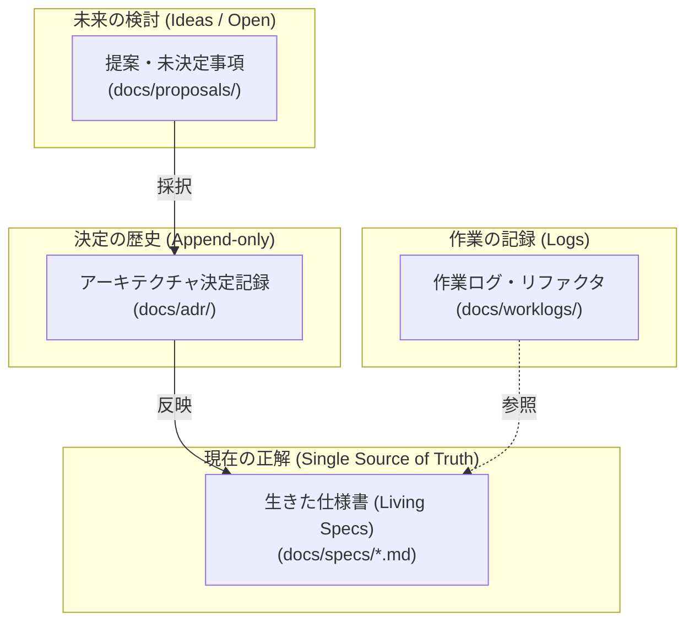

# Vy ドキュメント案内

Vy の設計・開発ドキュメントへようこそ。このディレクトリ配下の文書は、目的とライフサイクルに応じて以下の 4 つの役割に分かれています。



---

## 1. どこに何があるか

### ① 開発ガイド・方針
- [`development.md`](./development.md): 開発環境、言語ルール、テスト・ビルド・検証の手順。
- [`roadmap.md`](./roadmap.md): 実装フェーズの全体計画と現在の進捗。

### ② 生きた仕様書 (Living Specs)
「いまシステムがどう設計・実装されているか」の唯一の正解（SSOT）です。常に最新の状態にメンテナンスされます。一覧は [`specs/`](./specs/README.md) にあります。
- [`specs/architecture.md`](./specs/architecture.md): 全体アーキテクチャ、プロセスモデル、状態の所在。
- [`specs/protocol.md`](./specs/protocol.md): クライアント・コア間の RPC 通信プロトコル仕様。
- [`specs/api.md`](./specs/api.md): プラグイン・設定に公開する API 一覧と仕様。
- [`specs/plugin-system.md`](./specs/plugin-system.md): プラグインの構造、読み込み、実行サンドボックス。
- [`specs/ui.md`](./specs/ui.md): プラグイン UI ウィジェット、描画モデル。
- [`specs/panes.md`](./specs/panes.md): ペイン分割、レイアウトツリー。
- [`specs/commands.md`](./specs/commands.md): コマンドパレット、Ex コマンドライン、キーバインド。
- [`specs/keymap.md`](./specs/keymap.md): モードごとのキーマップ一覧と実装状況。
- [`specs/layout.md`](./specs/layout.md): ディレクトリ構成、設定ファイル・キャッシュの配置場所。

### ③ アーキテクチャ決定記録 (ADR)
- [`adr/`](./adr/README.md): 「なぜその設計にしたのか」という意思決定の歴史的記録です。一度採択された ADR は原則として変更されず、方針を変える際は新しい ADR を追加します。

### ④ 提案・設計検討 (Proposals)
- [`proposals/`](./proposals/README.md): 未決定事項の議論、新機能の設計検討、RFC 置き場です。合意された内容は ADR や仕様書へ反映されます。

### ⑤ 作業ログ (Worklogs)
- [`worklogs/`](./worklogs/README.md): 大規模なリファクタリング、移行作業、性能改善などの計画と実施ログを記録します。

---

## 2. メタデータ (frontmatter) 規約

ドキュメントの検索性・機械可読性を保つため、すべての Markdown ドキュメントの先頭には YAML frontmatter を配置します。

```yaml
---
title: "ドキュメントタイトル"
type: "spec" # "spec" | "adr" | "proposal" | "worklog" | "guide"
updated_at: 2026-10-25
---
```

各ドキュメント種別ごとの拡張項目（`status`, `related_adrs`, `supersedes` 等）の詳細は [`development.md`](./development.md) を参照してください。

