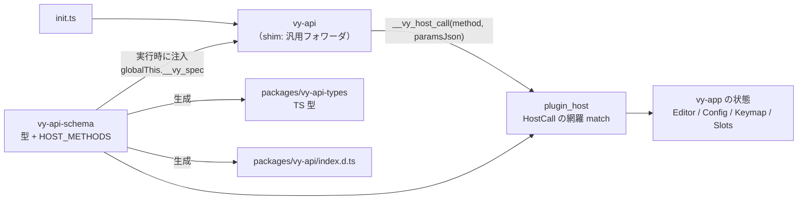

# ADR 0007: プラグイン境界の型は Rust を正とする

- 状態: 採用
- 日付: 2026-10-23

## 文脈

Phase 2 のプラグイン境界は、3 つの独立した記述でできていました。

1. `crates/vy-js/src/shim.js`（約 620
   行）。メソッドごとの薄いラッパと、状態を持つハンドル（`Document`、ステータスライン項目、ピッカー、ビュー、プロバイダのマップ）。
2. `packages/vy-api/index.d.ts`。手書きの型定義。
3. `crates/vy-app/src/plugin_host.rs`。`"editor.setMode"` のような文字列 match
   と、`text_param(...).unwrap_or_default()` による緩い変換。

同じ API が 3 箇所に書かれ、互いを検査する仕組みがありません。追加のたびに 3
箇所を直す必要があり、片方だけ直すと実行時に食い違います。実際に、`ui.statusline.createItem`
の `alignment` は不正値が `Left` に化け、widget の `gap` と `variant`
は未知の文字列が黙って既定の見た目になり、`notifications.show` の `level` は
Rust
側で無視されていました。境界が緩いと、プラグイン作者の誤りが「動いているように見える」状態で残ります。

また、文字列で表現されている値が多くあります。コマンド
id、設定キー、モード名、色トークン、配置、gap、フォント、ボタンの
variant、ログレベル。これらは列挙か newtype
で表現できるにもかかわらず、文字列として境界を通り、消費する側（`ui/statusline.rs`、`ui/widget.rs`、`ui/pane.rs`）がそれぞれ文字列
match を書いていました。

Phase 3 以降、API
は増えます（ペイン、ビュー、イベント、ファイル、プロセス）。増えるほど「3
箇所同期」は破綻します。境界の型に単一の情報源を決める必要があります。

## 決定ドライバ

1. **単一情報源**: 型と API の一覧が 1
   つの場所にあり、他はそこから導かれること。
2. **境界の厳格さ**: 不正な値は既定値に化けず、`InvalidParams`
   として失敗すること。
3. **追従コスト**: API を 1 つ足すときに触る場所が 1 つであること。
4. **実行時の軽さ**: QuickJS
   の起動とホスト呼び出しに追加の依存や変換層を持ち込まないこと。
5. **レビュー容易性**:
   生成物が読めて、差分がレビューできること。手書きと同じくらい追跡できること。
6. **方針との整合**:
   クライアントとコアは別プロセス（[ADR 0002](./0002-process-model.md)）、UI
   はウィジェット木（[ADR 0005](./0005-native-plugin-ui.md)）、位置は UTF-16
   で数える。

## 検討した選択肢

| 選択肢                                                    | 内容                                                                                                                                                        | 評価                                                                                                                                                 |
| :-------------------------------------------------------- | :---------------------------------------------------------------------------------------------------------------------------------------------------------- | :--------------------------------------------------------------------------------------------------------------------------------------------------- |
| **A. 現状維持**                                           | shim、d.ts、文字列ディスパッチを手書きし続ける                                                                                                              | 変更は最小だが、同期漏れと型ドリフトが残る。API が増えるほど破綻する。                                                                               |
| **B. TypeScript を正とし Rust を生成**                    | d.ts を手で書き、Rust の params 型とディスパッチを生成する                                                                                                  | プラグイン作者の体験は良いが、コアの状態と寿命は Rust が持つため、実行時の正が TS になるのは不自然。生成器が Rust の所有権・エラー型を表現できない。 |
| **C. コード共有（napi-rs / WASM）**                       | 同一の Rust コードを JS から直接呼ぶ                                                                                                                        | 実行環境が QuickJS であり napi-rs は使えない。WASM はバッファの正を持つコアとの境界（ADR 0002）を壊し、メモリ上限の扱いも変わる。                    |
| **D. Rust のスキーマ crate + 生成物 + 汎用 shim（採用）** | 境界の型とメソッド表を gpui / rquickjs 非依存の crate に置き、TS 型・d.ts を生成する。shim はメソッド表を実行時に受け取り、汎用のフォワーダとして組み立てる | 単一情報源になり、境界が厳格になり、shim が小さくなる。生成器は「型」と「名前空間」だけを扱えばよく、JS の流儀を表現しなくてよい。                   |
| **E. Rust からネイティブ関数・クラスを登録**              | rquickjs で全 API を関数・クラスとして公開し、shim を廃止する                                                                                               | 境界は最短になるが、Promise、ビルダー、リスナーの登録といった JS の流儀をすべて Rust で書くことになり、Rust 側が肥大化する。                         |

## 決定

### 1. 境界の型は `vy-api-schema` が持つ

`crates/vy-api-schema`
を新設し、プラグイン境界に現れる型の唯一の定義場所にします。この crate は GPUI
にも rquickjs にも依存しません。依存は
`serde`、`serde_json`、`thiserror`、`ts-rs`、`vy-core` だけです。

- **値型**: `Mode`、`ThemeColor`、`StatuslineAlignment`、`Gap`、`Font`、`ButtonVariant`、`LogLevel`、通知のレベル、`WidgetNode`
  とその構成要素。
- **メソッド型**: メソッドごとの params と result。すべて `Serialize` /
  `Deserialize` / `TS` を導出します。
- **メソッド表**: `HOST_METHODS`。各エントリはメソッド名、params 型名、result
  型名、`manual` フラグを持ちます。`manual` は、JS
  側に状態やコールバックがあり、汎用のフォワーダでは表現できないメソッドを指します。
- **既存型の再利用**: `Uri`、`Position`、`Range`、`Selection`、`TextEdit` は
  `vy-core` の定義をそのまま使います。境界専用の複製は作りません。

`Mode`、`WidgetNode`、`StatuslineAlignment` は現在 `vy-app`
にありますが、定義をスキーマ crate へ移し、`vy-app`
側は再エクスポートします。これにより、クライアント内部の型と境界の型が同じであることがコンパイル時に保証されます。

### 2. メソッド表が API の正であり、ホストのディスパッチも型で閉じる

`plugin_host.rs` の文字列 match は、メソッド名を列挙した `HostCall` の網羅 match
に置き換えます。パラメータは腕ごとにスキーマの型へ復元します。メソッドを足すと、列挙とホストの
match の両方がコンパイルエラーになり、メソッド表との一致はテストで確かめます。

params は型付きで復元します。欠落、型違い、範囲外は `InvalidParams`
として返し、既定値で埋めません。エラーコードは文字列リテラルではなく
`vy_proto::ErrorCode` を使い、`InvalidParams` を追加します。

### 3. shim は汎用フォワーダで、メソッドごとのコードを持たない

シムは次の 2 つに分けます。

- **コア（手書き、約 150〜200 行）**: `__vy_host_call` の JSON 境界、`ErrorCode`
  を持つ例外、メソッド表を回して名前空間を組み立てるフォワーダ、コマンドハンドラの表、設定変更リスナー、`Document`
  ラッパー、`editor.edit` の受け口（`TextEdit[]` とビルダーの両方を受ける）。
- **メソッド表（Rust から注入）**: `vm.rs` が `ScriptEnv` と並べて
  `globalThis.__vy_spec` を設定します。shim は表を読み、`manual`
  でないメソッドについて `(params) => call(method, params)` を生成します。

shim は「どのメソッドがあるか」を知りません。API の追加はスキーマ crate
だけで完結し、shim
の差分はゼロです。ホストから呼ばれないプロバイダのマップ（ピッカー、ガター、ホバー）は、呼び出し経路ができるまで
API から外します。状態を持つハンドルは、ホストが id で管理し、JS 側は明示的な id
付き呼び出しにします。

### 4. 生成物はコミットし、テストで再生成する

`cargo test --workspace export_bindings` が次のすべてを書き出します。

- `packages/vy-api-types/*.ts`（ts-rs。既存）
- `packages/vy-api-types/HostMethods.ts`（メソッド名 → params / result の
  interface）
- `packages/vy-api-types/CommandId.ts`（組み込み・ペイン・UI・文書コマンドの
  id）
- `packages/vy-api-types/SettingsKey.ts`（設定の既定キーと値の型）
- `packages/vy-api/index.d.ts`（名前空間、シグネチャ、Rust の doc
  コメントから流した JSDoc）

生成物はリポジトリにコミットし、CI で `git diff --exit-code`
を検査します。生成元はファイル冒頭に書き、手編集を禁止します。TS
の型にしか存在しない概念（`Disposable` など）と、JS の糖衣（`Document`
のメソッド、`edit` のヘルパ、リスナー登録）は `packages/vy-api/overrides.d.ts`
に隔離し、生成側はそれを合成するだけにします。

### 5. 文字列は境界で検証し、内部では型にする

色、配置、gap、フォント、variant、ログレベル、通知レベルは列挙で表します。JS
側では文字列リテラルの union として見え、Rust
側では列挙として扱います。変換は境界で 1 回だけ行い、失敗は `InvalidParams`
です。描画側の文字列
match（`ui/statusline.rs`、`ui/widget.rs`、`ui/pane.rs`）は網羅 match
に置き換え、未知の値が既定の見た目に化ける経路をなくします。

コマンド id と設定キーは、既知の集合を union
として公開し、未知の文字列も許可するオーバーロードを併設します（§6）。既知の id
では引数まで型が付き、未知の id では `unknown` に落ちます。

`when`
だけは例外です。これは式言語であり、列挙では表現できません。文字列のまま受け取り、バインド時に
Rust で解析し、失敗をエラーとして返します（現状の `when::parse`
を維持）。評価時に未知の識別子を false とする現在の挙動は、`keymap.setContext`
で後から名前を足せるようにするためです。

### 6. 拡張点は open interface として生成する

生成する d.ts は、プラグイン作者が宣言マージで型を足せる形にします。API を閉じた
union だけで記述すると、あとから拡張できません。次の 3 つを守ります。

- **拡張点を export した interface にする**: `CommandMap`（コマンド id →
  引数）、`SettingsMap`（設定キー → 値）、Phase 3 の `EventMap`（トピック →
  payload）を `export interface` として出します。既知の id の union
  は補完のためのショートカットに留め、シグネチャは `keyof CommandMap`
  を基準にします。union を基準にすると宣言マージが効きません。
- **未知の文字列のフォールバックを残す**: `(id: string, args?: unknown)`
  のオーバーロードを併設します。拡張 d.ts
  を読み込んでいないプロジェクトでも呼べるようにするためです。フォールバックがあるため、拡張した
  id に誤った引数を渡しても型エラーにはならず `unknown`
  として通ります。実行時の検証は引数スキーマで補う想定です。
- **値の語彙は閉じる**: `Mode`、`Color` など描画側が網羅 match
  する型は拡張対象にしません。拡張してよいのは id
  と名前空間だけです。これで「型で開いている範囲」と「ホストが受け付ける範囲」が一致します。

ランタイム契約はこの拡張と整合します。`CommandRegistry::register` は任意の id
を受け付け（重複だけがエラー）、`Config::apply`
はメモリ層に任意のキーを保存します。型レベルで足した id
やキーは、ホスト側を変えずに動きます。逆に、ホストが列挙で閉じている語彙は型でも開けません。

拡張は生成物の外に置きます。プラグインは自前の `.d.ts` を同梱し、利用者はそれを
tsconfig の `include` に加えます。宣言マージは同じ TS
プログラム内でしか効かないため、`init.ts` に tsconfig
を用意する導線（`vy types sync` など）が要ります。

型は Oxc
で除去され、実行時には存在しません。型と実装のズレを実行時に検出する仕組みは、この決定では持ちません（引数スキーマの導入は未決定事項）。

### 7. 検証

- メソッド表と `HostCall`
  の名前が一致することをテストします。ディスパッチは列挙を網羅するため、表の全項目が必ず処理されます。
- params の欠落・型違いが `InvalidParams` になることをテストします。
- 生成物に差分が出ないことを確認します。
- `examples/init.ts` を新しい API で書き、型検査の対象にします。
- 拡張 d.ts を当てた場合と当てない場合の両方で、`init.ts`
  が型検査を通ることを確認します（当てた場合は引数が型付きになり、当てない場合は
  `unknown` に落ちる）。

## 帰結

### 良い面

- API の追加・変更がスキーマ crate の 1 箇所で完結し、shim と d.ts
  は追従します。同期漏れという失敗の仕方がなくなります。
- 型が 1 箇所から出るため、JS の型と Rust の実行時の型が食い違いません。
- 境界が厳格になり、プラグイン作者の誤りが呼び出し時に表面化します。既定値への
  silent fallback がなくなります。
- shim が小さいため、QuickJS が読むコードが減り、境界の挙動を 1
  度読めば把握できます。
- 色や gap などの語彙が列挙になるため、描画側の match
  が網羅的になり、見た目の既定が暗黙に決まりません。
- プラグイン作者は、自分のコマンド引数・設定・イベントの型を宣言マージで足せます。`init.ts`
  からは補完と型検査が効いた状態で参照でき、ホスト側の変更は要りません。

### 悪い面・課題

- スキーマ crate が新しい依存の中心になります。`vy-app` の内部型（`Mode`
  など）を移す必要があり、短期的には移動の差分が出ます。再エクスポートで呼び出し側の変更は抑えます。
- 生成物の差分がレビューでノイズになります。JSDoc を Rust の doc
  から流し、レビューはスキーマ側で行う運用にします。
- d.ts
  の生成器自体が保守対象になります。生成器の不具合で型だけが壊れる可能性があります。`examples/init.ts`
  の型検査と、メソッド表の網羅テストで検出します。
- 実行時にメソッド表の JSON を 1 度解析するコストが増えます。起動時の 1
  回だけで、ホスト呼び出しの経路には乗りません。
- 状態を持つハンドルを減らすと、JS 側の呼び出しが id
  付きで冗長になります。`Document` のような頻出のものだけを糖衣として残します。
- 拡張は型だけの仕組みです。型は Oxc
  で除去されるため、型と実装のズレ（引数の形、設定値の型）は実行時に検出されません。
- 宣言マージは同じ TS プログラム内でしか効きません。拡張 d.ts
  を配る導線と、`init.ts` 用の tsconfig が無いと、型安全な参照は成立しません。
- 同じ id を 2 つのプラグインが拡張すると、TS
  は重複プロパティとしてエラーにします。ランタイムの重複登録エラーと挙動は揃いますが、どちらが勝つかを決める規則は別に要ります（現状は後の登録がエラー）。

### 緩和策

- 生成物には生成コマンドと生成元をヘッダに書き、手編集を禁止します。
- 糖衣は `overrides.d.ts` と shim
  のコアに限定し、境界の本体（メソッド表）と混ざらないようにします。
- 厳格化で壊れる既存の `init.ts` は、後方互換を取らずに移行ガイドを
  `docs/api.md` に書きます（Phase 2 の利用者は開発者だけです）。
- 拡張の配布は、まずプラグイン同梱の `.d.ts` を `include`
  する方式にします。集約が必要になったら `vy types sync`
  でインストール済みプラグインの宣言を 1 つの d.ts にまとめ、利用者はその 1
  ファイルを include します。

## 見直しの条件

- Phase 3 でイベント API（`onDidChangeSelection`
  など）とプロバイダのコールバックが入り、ホストから JS
  を呼ぶ経路が増えたとき。イベント表も同じ生成系に載せるかを決め直します。
- 外部プラグインのマニフェストと承認 UI が入り、`backend.ts` と共有する RPC
  型まで範囲を広げるとき。
- 型生成に成熟した仕組み（specta など）へ移りたくなったとき。現状は `ts-rs`
  と小さな生成器で足りています。
- 生成物の差分がレビューを圧迫し、実行時注入では追いつかなくなったとき（shim
  の完全生成へ切り替える判断）。
- 拡張 d.ts の配布がプラグイン同梱で回らなくなったとき（`vy types sync`
  による集約、またはマニフェストからの型生成へ移る判断）。

## 関連する未決定事項

- `keymap.bind` の `keys` を文字列のままにするか、キーの配列にするか（現状は文字列）。
- プロバイダ
  API（`ui.picker.registerSource`、ガター、ホバー）は、ホストから JS
  の関数を呼ぶ経路ができるまで API から削除した。Phase 3 で戻すか、ホスト主導の問い合わせに変えるかを決めます。
- `when` を文字列の式から構造化した条件木にするか。
- イベント API の型生成方法と、購読の上限（[`api.md`](../api.md) §22）。
- 生成物の差分を検査する CI の整備（現状は手元のコマンドのみ）。
- 拡張 d.ts の配布方法。プラグインが同梱するか、`vy types sync`
  がインストール済みプラグインの宣言を集約するか。
- `init.ts` 用の tsconfig
  をどこに生成するか（設定ディレクトリか、一時的な型ディレクトリか）。
- 型と実行時のズレを防ぐ引数スキーマ検証をいつ入れるか。マニフェストにコマンド引数・設定・イベントのスキーマを書かせ、`vy plugin build`
  が `CommandMap` などを生成する案（型と検証を同じ定義から出す）を候補にします。
