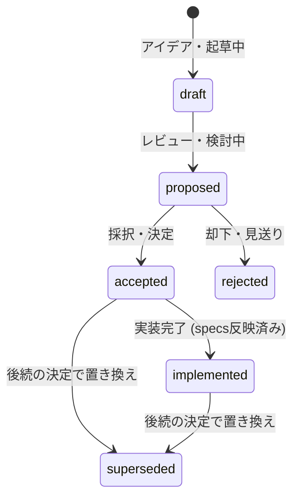

# アーキテクチャ決定・提案記録 (ADR)

Vy の設計上の提案・決定・ロードマップを記録します。アイデア起草から設計議論、採択、実装完了、そして将来の置き換えまでのライフサイクルを、frontmatter のステータスとカテゴリーで一元管理します。

決定を変えるときは既存のファイルを書き換えず、新しい ADR を追加します。古い ADR は `superseded` とし、[`superseded/`](./superseded/README.md) へ移動します。

## ライフサイクルとステータス



| ステータス    | 意味                                                              |
| :------------ | :---------------------------------------------------------------- |
| `draft`       | アイデア出し・起草中・ブレスト段階                                |
| `proposed`    | 方針案がまとまり、決定に向けた検討・レビュー中                    |
| `accepted`    | 採択・決定済み（実装待ちまたは実装中）                            |
| `implemented` | 実装完了し、現在の確定仕様は `docs/specs/` に反映済み             |
| `rejected`    | 検討の結果、見送り・却下                                          |
| `superseded`  | 後続の決定によって置き換えられた（`docs/adr/superseded/` へ移動） |

## カテゴリー

| カテゴリー     | 説明                                                                     | 主な対象                                                 |
| :------------- | :----------------------------------------------------------------------- | :------------------------------------------------------- |
| `roadmap`      | 複数機能にまたがる大きなフェーズ計画やマイルストーン                     | Phase 6, Phase 7, Phase 8 など                           |
| `architecture` | プロセスモデル、RPC プロトコル、プラグイン基盤、型システムなどの根幹設計 | プロセス分離、型付き RPC、Specta 型生成など              |
| `feature`      | 個別の新機能、UI ウィジェット、キーマップ、エディタ操作の仕様・計画      | キーボードファースト UI、コマンド面分離など              |
| `maintenance`  | 内部モデルのリファクタリング、安全性向上、CI/インフラ負債解消            | 純粋ロジック状態整理、実行時安全性・セキュリティ整理など |

## frontmatter 規約

各 ADR の先頭には以下の frontmatter を付与します。

```yaml
---
id: "0024"
title: "キーボードファーストなプラグイン UI"
type: "adr"
status: "accepted" # draft | proposed | accepted | implemented | rejected | superseded
category: "feature" # roadmap | architecture | feature | maintenance
date: 2026-10-27
tags: ["ui", "keymap", "plugin", "focus"]
supersedes: [] # 任意: 置き換えた過去のADR番号
superseded_by: null # 任意: 置き換えられた新しいADR番号
related_adrs: [] # 任意: 関連するADR番号
---
```

## 命名規則

ファイル名は `NNNN-<short-title>.md` とします。番号は4桁で、追加した順に増やします。

---

## カテゴリー別一覧

### 1. ロードマップ (`roadmap`)

大きな開発フェーズとマイルストーンの計画です。

| 番号                                           | タイトル                          | ステータス | 概要                                                     |
| :--------------------------------------------- | :-------------------------------- | :--------- | :------------------------------------------------------- |
| [0026](./0026-phase-6-remote-plugins.md)       | Phase 6: リモートプラグイン       | proposed   | `backend.ts` のコア側実行、通信チャネル、型分離          |
| [0027](./0027-phase-7-language-features.md)    | Phase 7: 言語機能・エディタ実用化 | proposed   | Tree-sitter、非同期 LSP、補完プロバイダ、検索            |
| [0028](./0028-phase-8-webview-and-notebook.md) | Phase 8: Webview・Notebook        | proposed   | gpui-kit/webview 組み込み、Markdown プレビュー、セル描画 |

### 2. アーキテクチャ・基盤 (`architecture`)

| 番号                                                 | タイトル                                                             | ステータス  | 概要                                                                |
| :--------------------------------------------------- | :------------------------------------------------------------------- | :---------- | :------------------------------------------------------------------ |
| [0001](./0001-ui-framework.md)                       | UI フレームワークに GPUI と gpui-kit を採用する                      | implemented | GPUI と gpui-kit の採用                                             |
| [0002](./0002-process-model.md)                      | クライアントとコアを常に別プロセスにする                             | implemented | 独立プロセスと IPC 通信                                             |
| [0003](./0003-editor-state.md)                       | 編集状態をコアとクライアントに分ける                                 | implemented | 編集状態の分離（アンドゥは 0004 で置き換え）                        |
| [0004](./0004-undo-in-core.md)                       | アンドゥの履歴はコアが持つ                                           | implemented | コア所有アンドゥ                                                    |
| [0005](./0005-native-plugin-ui.md)                   | プラグイン UI はネイティブのウィジェット木で作る                     | implemented | ネイティブ木による安全な UI 構築                                    |
| [0010](./0010-remote-connection.md)                  | リモート接続の寿命、再接続、配備                                     | accepted    | SSH 接続と再同期セッション                                          |
| [0011](./0011-backend-plugins-on-core.md)            | バックエンドプラグインはコアで動かす                                 | accepted    | バックエンドプラグインの配置（実装は Phase 6）                      |
| [0017](./0017-cli-parsing-with-usage-rs.md)          | CLI 引数の解析に usage-rs を使う                                     | implemented | usage-rs による引数解析                                             |
| [0018](./0018-typed-rpc.md)                          | クライアント・コア間の RPC は型付き marker で送る                    | implemented | 型付き RPC 通信                                                     |
| [0019](./0019-global-vy-api.md)                      | プラグイン API はグローバル vy に統一する                            | implemented | グローバル `vy` への集約                                            |
| [0020](./0020-plugin-source-and-bundles.md)          | プラグインはソース形態とバンドル形態の2つを許す                      | implemented | ソース・バンドルの 2 形態許可                                       |
| [0021](./0021-bundle-validation.md)                  | バンドル検証とエントリの制限                                         | implemented | ロード時のバンドル整合性検査                                        |
| [0022](./0022-command-surfaces.md)                   | コマンドの入口と設定の分離                                           | implemented | コマンド面と設定状態の分離                                          |
| [0025](./0025-plugin-api-declaration-and-codegen.md) | プラグイン API の宣言・型・生成を名前空間 trait と Specta に集約する | implemented | Specta 型生成と trait 一本化（0007-0009, 0012-0016, 0023 を集約）   |
| [0032](./0032-floating-surfaces.md)                  | 浮遊 UI をサーフェスとフローティングペインの 2 層に分ける            | accepted    | 任意矩形のサーフェス、z 順、picker のプレビュー、浮遊 UI のキー経路 |
| [0033](./0033-config-directory.md)                   | 設定ディレクトリはすべての OS で `~/.config/vy` に統一する           | implemented | macOS でも `~/.config/vy`、data/cache はプラットフォーム既定        |

### 3. 機能・UX (`feature`)

| 番号                                           | タイトル                                         | ステータス  | 概要                                                         |
| :--------------------------------------------- | :----------------------------------------------- | :---------- | :----------------------------------------------------------- |
| [0006](./0006-user-controlled-ui-and-slots.md) | ユーザー制御 UI とスロットによるステータスライン | implemented | スロット構造とユーザー主導 UI                                |
| [0024](./0024-keyboard-first-plugin-ui.md)     | キーボードファーストなプラグイン UI              | accepted    | フォーカス層、コンテキスト、セマンティックアクション、picker |
| [0029](./0029-editor-ux-and-keymap.md)         | エディタ操作・キーマップ・UI拡張                 | proposed    | 未実装キーバインド、Ex コマンド、ステータスライン、CRLF      |

### 4. 改善・保守 (`maintenance`)

| 番号                                                | タイトル                                               | ステータス  | 概要                                                   |
| :-------------------------------------------------- | :----------------------------------------------------- | :---------- | :----------------------------------------------------- |
| [0030](./0030-logic-state-refactor.md)              | 純粋ロジックの状態モデル整理計画                       | accepted    | 入力状態の enum 化、視覚行計算の単一実装               |
| [0031](./0031-runtime-safety-and-infrastructure.md) | 実行時・基盤・セキュリティの負債整理計画               | accepted    | 保存の原子性、未保存保護、ケイパビリティ境界、CI       |
| [0034](./0034-keymap-context-and-blocks.md)         | キーマップコンテキストの直交化とブロック構造への再構成 | implemented | フォーカスの単一化、直交述語、単層コンテキストブロック |

---

## 置き換えられた ADR (Superseded)

方針変更により置き換えられた過去の ADR は [`superseded/`](./superseded/README.md) に保管されています。
