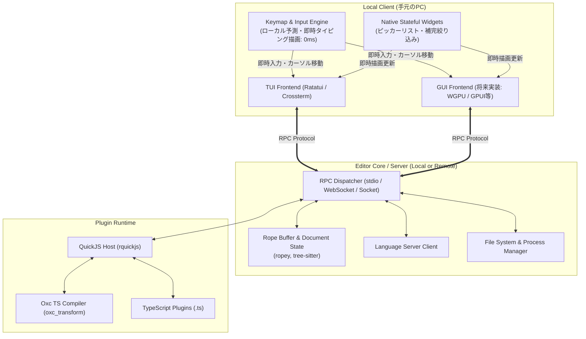

# 全体アーキテクチャ設計

Vy は、Vimのモーダル編集の軽快さと、VS Codeの拡張性・リモート開発体験を両立するため、**「UIフロントエンド」** と **「エディタコア/バックエンド」** を完全に物理分離するクライアント/サーバー構成を採用しています。

---

## 1. システム全体図

---

## 2. クライアント/サーバー分離とリモート開発

### ヘッドレス・サーバーモード
エディタのコア（バッファ管理、構文解析、LSPクライアント、プラグイン実行）は、ヘッドレスバイナリ（`vy-server`）として動作可能です。
- **ローカル起動**: 内部チャネル（In-memory channel / Unix Domain Socket）でクライアントと直結。
- **リモート起動**: SSHトンネル越し、Dockerコンテナ内、またはCloud環境で起動し、stdioやWebSocket経由でローカルクライアントと接続。

### リモート環境における入力遅延ゼロ化 (Optimistic Updates)
ネットワーク経由での編集において、文字を1打鍵するたびにサーバーの往復（RTT）を待つと耐え難い遅延が発生します。
Vyでは以下の設計により **手元のディスプレイのリフレッシュレート（60Hz/120Hz）に完全同期** させます：
1. **テキスト入力・カーソル移動**: ローカルクライアント側で先行反映（予測描画）し、サーバーへは操作イベント（差分）を非同期送信。
2. **ピッカー/補完の操作**: 検索語の入力欄やリストの上下カーソル移動は、ローカルクライアントがネイティブウィジェットとしてローカル完結で描画。

---

## 3. コア技術選定

| コンポーネント | 採用技術 | 選定理由 |
| :--- | :--- | :--- |
| **言語** | **Rust** | メモリ安全性、ゼロコスト抽象化、クロスプラットフォーム、Cバインディング親和性 |
| **テキストバッファ** | **`ropey`** | Ropeデータ構造により、巨大ファイルでもO(log N)での高速挿入・削除 |
| **構文解析** | **`tree-sitter`** | インクリメンタルパース、高精度ハイライト、ASTベースのテキストオブジェクト |
| **非同期ランタイム** | **`tokio`** | ファイルIO、プロセス管理、LSP通信、ネットワークRPCの非同期制御 |
| **TUIフロントエンド** | **`ratatui` + `crossterm`** | 軽量、高速、豊富なエコシステムと安定性 |

---

## 4. これから決めること (TODO / 未決定事項)

- [ ] **GUIフロントエンドの描画ライブラリ選定** (後述ロードマップ参照)
  - WGPUベースの自作か、Zedが開発したGPUI、あるいはIced/Vello等を採用するかはGUI着手時に決定。
- [ ] **マルチユーザー同時編集 (CRDT) の要否**
  - 単純なクライアント/サーバー同期とするか、将来的な共同編集を見据えてCRDT（Diamond-types等）をコアに組み込むか。
