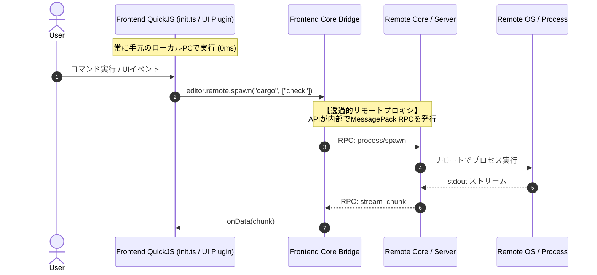

# プラグインシステム & 設定仕様 (`init.ts`)

Vy は、**「フロントエンド主導のTypeScript実行環境」** を基本とし、APIを通じて透過的にローカルとリモートを切り替える設計を採用しています。

---

## 1. 設定ファイル: `init.ts` (Neovimの `init.lua` モデル)

設定はすべてTypeScriptで記述します。エディタが `vy-api.d.ts` を提供するため、VS CodeやVy自身で完全な型補完・静的型チェックが効きます。

```typescript
// ~/.config/vy/init.ts
import { editor, keymap } from "vy-api";

// 1. エディタ外観・基本設定 (フロントエンドで即時反映)
editor.config.set({
  theme: "one-dark",
  fontFamily: "JetBrains Mono",
  fontSize: 14,
  lineNumbers: "relative",
});

// 2. Helix風キーバインドのカスタマイズ (Selection -> Action)
keymap.bind("normal", "space f f", async () => {
  await editor.commands.execute("find_files");
});

// 3. LSP設定
editor.lsp.setup("rust-analyzer", {
  serverPath: "rust-analyzer",
  settings: {
    checkOnSave: { command: "clippy" }
  }
});
```

---

## 2. 実行場所のアーキテクチャ: 「フロント主導 + 透過的リモートプロキシ」



### なぜこの設計が最高なのか？
1. **設定のポータビリティ**:
   - `init.ts` は常に手元のローカルPCで評価されます。SSH接続先のサーバーに設定ファイルを配布・同期する必要はありません。
2. **UI操作のゼロ遅延**:
   - ウィンドウの分割、Webviewの作成、テーマ変更などのUI操作はネットワークを経由せず、フロントエンドで即座に実行されます。
3. **リモート操作の透過性**:
   - `editor.fs` や `editor.remote` などのAPIを呼ぶと、コア層が自動的に「現在接続中のリモートサーバー」に対するMessagePack RPCへルーティングします。

---

## 3. 大量データ処理のための「バックエンドプラグイン」オプション

フロントエンドでJSを動かす場合、ripgrepなどの検索結果が数十万行に及ぶと、生テキストをすべて手元に転送するのは帯域とメモリを浪費します。

そのため、プラグインは必要に応じて **`backend.ts`（リモートサーバー側QuickJSで動作）** を併設できるハイブリッド構成をサポートします：
- **`frontend.ts`**: UIウィジェットの定義、Webview表示、キー受付
- **`backend.ts`**: リモートサーバー側での重いデータパース、ローカルファイル監視、外部プロセスとのパイプ結合
- **通信**: `postMessage` による型安全なチャネル通信
