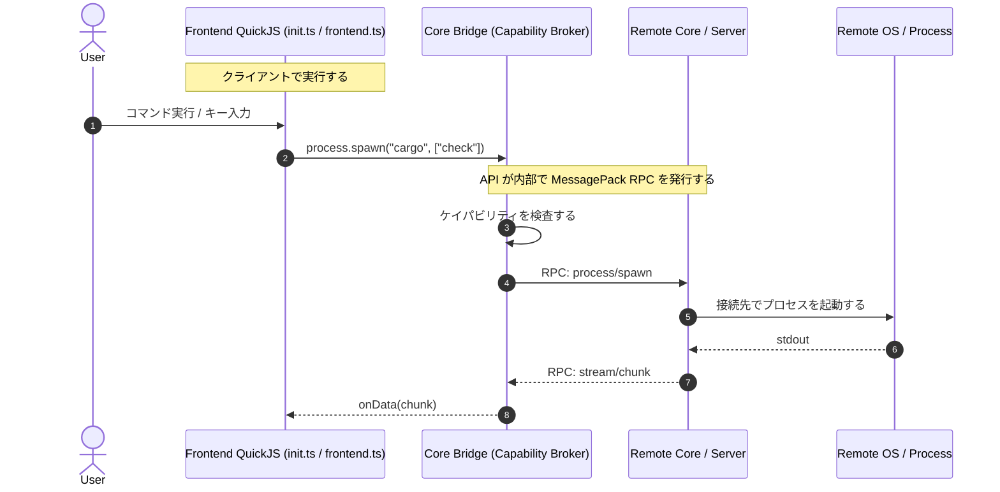

# プラグインシステムと設定

Vy は、クライアント側の TypeScript を入口にし、API
の中でローカルとリモートを切り替える設計を採用しています。設定とプラグインの API
は [`api.md`](./api.md) に列挙し、置き場所は [`layout.md`](./layout.md)
に決めました。

---

## 1. 設定ファイル

設定は2種類に分けます。`init.ts`
は条件式や関数を含む設定を書くスクリプトです。`settings.json`
は値だけの恒久的な設定です。実行中に変えた値はメモリ層とウィンドウの上書きに
入り、`settings.json` は書き換えません （[`commands.md`](./commands.md)
の「設定」）。

`init.ts`
は起動時に1回評価し、そのあとはファイルの変更を監視して再評価します。再評価のときは、前回の登録をすべて破棄してから読み直します。コマンド
ID の重複を防ぐためです。

### 1.1 init.ts

```typescript
// ~/.config/vy/init.ts
import type {} from "vy-api";

vy.config.set({
  values: {
    "ui.fontFamily": "JetBrains Mono",
    "ui.fontSize": 14,
    "ui.lineNumbers": "relative",
  },
});

vy.keymap.bind({
  keys: "space u",
  command: "user.uppercase-selection",
  when: "normalMode",
});

vy.commands.register(
  {
    id: "user.uppercase-selection",
    title: "Uppercase Selection",
    category: "edit",
    exNames: ["upper"],
  },
  async () => {
    const active = await vy.editor.activeDocument();
    if (!active) return;
    const text = await vy.document.getText({ documentId: active.id });
    await vy.editor.edit({
      edits: [
        {
          range: {
            start: { line: 0, character: 0 },
            end: active.end,
          },
          text: text.toUpperCase(),
        },
      ],
    });
  },
);
```

`vy` はホストがインストールするグローバルで、import は不要です
（[ADR 0019](./adr/0019-global-vy-api.md)）。`vy-api` は型専用のパッケージで、
`import type {} from "vy-api"` を1回置くと `vy` と `Vy.CommandMap` が見えます。
`vy-api` から値を import することはできません。型定義は `packages/vy-api` が
提供し、Rust の型から `packages/vy-api/types` を生成するため、プロトコルの変更と
型定義がずれません。

コマンドのタイトル、カテゴリ、Ex 名、引数の宣言は `commands.register`
で行います。 `registerCommand` は ID とハンドラだけを渡す糖衣です。設計と
`args` の形は [`commands.md`](./commands.md) の「プラグイン」にあります。
Ex 名を登録できるのは信頼済みのプラグインだけで、組み込みや他のプラグインと
重複すると登録に失敗します。

### 1.2 settings.json

```json
{
  "ui.fontSize": 14,
  "ui.lineNumbers": "relative",
  "lsp.rust-analyzer.command": "rust-analyzer",
  "example.hello.greeting": "こんにちは"
}
```

プラグインが追加した設定は `<pluginId>.<key>` の形になります。項目の型と説明は
`config.define` で登録し、設定画面の生成と検証に使います。

### 1.3 設定の階層

設定は4層で解決し、下の層ほど優先します。

1. 組み込みの既定値
2. `~/.config/vy/settings.json`
3. `<workspace>/.vy/settings.json`
4. `init.ts` から呼んだ `config.set`

`init.ts` の値はメモリ上だけに反映し、ファイルには書きません。`config.inspect`
は各層の値と、どれが有効かを返します。

UI
の設定はクライアントが即座に反映します。言語サーバーや整形の設定は、リモートのコアに送ってから反映します。どちらの層が値を持つかは、キーの先頭（`ui.`、`editor.`、`lsp.`）で決まります。

### 1.4 Phase 2 の範囲

- 評価するのは `init.ts` だけです。外部プラグインの探索、マニフェスト、
  `activationEvents`、承認 UI は Phase 3 です。
- `init.ts` は常に信頼します。ケイパビリティの宣言、glob 照合、 `trusted.json`
  の読み書きは `vy-capabilities`
  に実装済みですが、承認を求めるのは外部プラグインだけです。
- `init.ts` は Oxc で型だけを除去してから QuickJS
  で評価します。構文の変換はしません。壊れたスクリプトは位置付きのエラーになり、アプリは落ちません。
- 評価は専用スレッドで行い、UI は待ちません。初期化は 1 秒、コマンド実行は 5
  秒で打ち切り、メモリは 64 MiB に制限します。
- ファイルの変更を検出すると、ランタイムを作り直して再評価します。コマンド、キーバインド、メモリ層の設定、リスナーは前回のぶんをすべて捨てます。
- ログは `~/.cache/vy/logs/init.log` に JSON Lines で書きます。

---

## 2. 実行場所のアーキテクチャ: 「フロント主導 + 透過的リモートプロキシ」



### 2.1 実行場所

`init.ts` と `frontend.ts`
はクライアントで評価します。接続先に設定ファイルを配布する必要がありません。

テーマの変更、`ui` ビューのウィジェット木、Webview
の作成はクライアントで完結します。ペインの分割はコアに要求し、確定したレイアウトを描画します。リモート接続でも同じ形を保ち、セッションの復元で崩れないようにするためです。詳しくは
[`panes.md`](./panes.md) と [`ui.md`](./ui.md) にまとめました。

UI は、クライアントが描くネイティブのウィジェット木で作ります。Webview は、Web
の文書を表示するときだけ使います。Webview
はキー入力とフォーカスを自分で持ち、ホストのキーマップを共有できないためです。

ファイル、プロセス、検索の API
は、コアのブリッジが接続先へ転送します。プラグインはリモートかローカルかを意識せず、同じ
API を呼びます。どちらを指すかは `fs` と `localFs` のように名前空間で分けます。

### 2.2 非同期とイベントループ

QuickJS は同期の処理系です。Promise
の解決を進めるには、ホスト側でジョブキューを回す必要があります。ホストはフレームの合間と
RPC の応答時にキューを消化します。

API が Promise を返すのは、リモートの応答を待つためです。同期の get
を用意すると、リモート接続時だけ挙動が変わるか、呼び出しをブロックするかのどちらかになります。どちらも避けます。

キー入力の処理は同期で終わらせません。キーマップの照合はクライアントで行い、登録されたコマンドの実行はタスクとして開始します。入力の描画を止めないためです。

未解決の Promise には制限時間を置きます。応答がないまま接続が切れた場合は
`RemoteDisconnected` で失敗させ、待ち続ける状態を残しません。

### 2.3 順序と再同期

同じ文書の変更イベントは version の昇順で届きます。クライアントは、受け取った
version が手元より新しいときだけ表示を更新します。

再接続したときは、クライアントが開いている文書の version
を送り、コアが差分か全文を返します。購読はセッション ID
に紐づけ、再接続で作り直します。詳しいメッセージは
[`protocol.md`](./protocol.md) を参照してください。

---

## 3. プラグインの構成

### 3.1 マニフェスト

プラグインの情報は `plugin.json` に書きます。項目の意味と配置は
[`layout.md`](./layout.md) に決めました。

```json
{
  "id": "example.hello",
  "name": "Hello",
  "version": "0.1.0",
  "engines": { "vy": ">=0.1.0" },
  "main": "dist/frontend.js",
  "backend": "dist/backend.js",
  "permissions": ["fs:read:${workspace}/**"],
  "activationEvents": ["onCommand:example.hello.greet"],
  "contributes": {
    "commands": [
      {
        "id": "example.hello.greet",
        "title": "Hello",
        "category": "Plugin",
        "exNames": ["hello"]
      }
    ],
    "configuration": {
      "example.hello.greeting": { "type": "string", "default": "こんにちは" }
    }
  }
}
```

`category` と `exNames` は任意です。省略すると `Plugin` と Ex 名なしになります。
Ex 名は信頼済みのプラグインだけが登録でき、組み込みと重複してはいけません
（[`commands.md`](./commands.md) の「プラグイン」）。

`permissions` と `contributes` は起動前に読みます。承認が済むまで `activate`
を呼ばないためです。

ソース形態では `main` に `frontend.ts` を指定します。`backend` は常にバンドル
（`dist/backend.js`）を指します。

### 3.2 ライフサイクル

プラグインは `activate(ctx)` を公開します。`deactivate()` は省略できます。

有効化の契機は `activationEvents` で指定します。

| 値                           | 契機                                             |
| :--------------------------- | :----------------------------------------------- |
| `onStartup`                  | 起動したとき                                     |
| `onCommand:<id>`             | コマンドを実行したとき                           |
| `onLanguage:<id>`            | その言語の文書を開いたとき                       |
| `onView:<id>`                | その `ui` ビューを開いたとき                     |
| `onWebview:<id>`             | その Webview を開いたとき                        |
| `onWorkspaceContains:<glob>` | 一致するファイルがあるワークスペースを開いたとき |

`activate` が返した Promise
が解決するまで、そのプラグインのコマンドは実行できません。解決前に実行された場合は、解決を待ってから実行します。

`ctx.subscriptions` に積んだ `Disposable`
は、無効化のときに逆順で破棄します。コマンド
ID、キーバインド、スロットの登録もここに含めます。同じ ID
を2回登録した場合はエラーにし、後の登録は受け付けません。

### 3.3 ケイパビリティと承認

ケイパビリティは、外部に影響する操作を列挙したものです。値は `種類:対象`
の形にし、対象はグロブまたは名前です。

| ケイパビリティ    | 例                            | 承認 |
| :---------------- | :---------------------------- | :--- |
| `fs:read`         | `fs:read:${workspace}/**`     | 必要 |
| `fs:write`        | `fs:write:${workspace}/**`    | 必要 |
| `fs:local:read`   | `fs:local:read:${home}/**`    | 必要 |
| `fs:local:write`  | `fs:local:write:${home}/**`   | 必要 |
| `process:exec`    | `process:exec:cargo`          | 必要 |
| `process:local`   | `process:local`               | 必要 |
| `net`             | `net:https://api.example.com` | 必要 |
| `openExternal`    | `openExternal:https://*`      | 必要 |
| `secrets`         | `secrets`                     | 必要 |
| `clipboard:read`  | `clipboard:read`              | 必要 |
| `clipboard:write` | `clipboard:write`             | 必要 |
| `workspace:state` | `workspace:state`             | 必要 |

検査は Rust 側で行います。JS
のシムで検査しても、プラグインがシムを迂回できるためです。

初回の有効化では、宣言されたケイパビリティを一覧で示して承認を得ます。承認はプラグイン
ID とバージョンの組で `trusted.json`
に記録します。バージョンを上げてケイパビリティが増えた場合は、増えた分だけを再承認します。減った場合は再承認を求めません。

組み込みのプラグインは承認を省略します。ビルトインの一覧はバイナリに含め、利用者が追加できないようにします。

### 3.4 モジュール解決と配布

プラグインには2つの形態があります（[ADR 0020](./adr/0020-plugin-source-and-bundles.md)）。

| 形態     | エントリ           | import   | 外部依存                     |
| :------- | :----------------- | :------- | :--------------------------- |
| ソース   | `frontend.ts`      | 相対のみ | なし（型だけの import は可） |
| バンドル | `dist/frontend.js` | なし     | ビルド時に同梱               |

`vy` はグローバルなので、どちらの形態でも import は不要です。

ソース形態では、プラグインのディレクトリをルートとして相対 import を解決します。
`./` と `../` だけを許可し、`.ts`、`.js`、`.mjs`、ディレクトリなら `index.ts` /
`index.js` を探します。JSX と `.tsx` は扱いません。ルート外への
脱出、`node_modules`、`node:*`、`.json`、WASM、`require` は許可しません。裸の
specifier（`vy-api` を含む）は「バンドルしてください」とエラーにします。

エントリの形態は拡張子で決めます。`main` が `.ts` ならソース、`.js` / `.mjs`
ならバンドルです。`backend` は `.js` / `.mjs` のバンドルだけを許可し、`.ts` は
拒否します。`main` と `backend` はプラグインのディレクトリ内の相対パスに限り、
絶対パス、`.`、`..`、ルート外へ出るシンボリックリンクを拒否します。エントリは
存在するファイルでなければなりません。

外部依存を使うプラグインは、`frontend.ts` を1ファイルの ESM にバンドルし、
`dist/` に置きます。バンドルは esbuild、tsup、rolldown-vite など一般の JS
ツールチェーンで作ります。Vy はバンドラも `vy plugin build` も持ちません。
利用者の環境で `node_modules` を解決しないためです。

```sh
esbuild frontend.ts --bundle --format=esm --platform=browser --target=es2022 \
  --outfile=dist/frontend.js
```

`backend.ts` はリモートへ1ファイルで送るため、常にバンドルします。

QuickJS のモジュールは ESM として読み込みます。CommonJS の `require` は提供
しません。バンドルはロード時に UTF-8 の JavaScript として解析し、静的 import、
`export ... from`、動的 `import()`、`require()` が残っていないことを確認します。
TypeScript と JSX の構文も拒否します。サイズ上限は 4 MiB で、サイズと SHA-256 を
計算して `PluginEntry` に保存します。バンドルはリロード時にもう一度検証します。

`engines.vy` はマニフェストの読み込み時に semver の範囲として解析し、現在の Vy
と 一致しないプラグインは警告を出して読み込みません。

配布は当面、ディレクトリを `plugins/` に置く方法だけにします。レジストリと
`vy plugin install` は Phase 4 以降に回します。

## 4. バックエンドプラグイン

検索結果が数十万行に及ぶ場合、生のテキストをすべてクライアントへ送ると帯域とメモリを使い切ります。そのため、プラグインは接続先で動く
`backend.ts`
を併設できます（[ADR 0011](./adr/0011-backend-plugins-on-core.md)）。

- `frontend.ts` は UI の登録（`ui`
  ビューのウィジェット木）、Webview、キー入力、設定を扱います。
- `backend.ts`
  は重いデータの解析、ファイル監視、外部プロセスとの結合を扱います。
- 2つの間はチャネルで通信します。チャネル名は文字列で指定します。

```typescript
// frontend.ts
const worker = vy.backend.connect("search");
worker.onMessage((chunk) => {
  render(chunk);
});
worker.postMessage({ query: "main", maxResults: 100 });
```

```typescript
// backend.ts
export function activate(ctx: BackendContext) {
  ctx.subscriptions.push(
    vy.backend.registerHandler("search", async (message, req) => {
      for await (
        const chunk of vy.workspace.grep(message.query, {
          signal: req.signal,
        })
      ) {
        req.postMessage(chunk);
      }
    }),
  );
}
```

バックエンドのコードは、クライアントが `plugin/load`
で送ります。コアはハッシュと
サイズを検証し、メモリにキャッシュします。接続先にプラグインをインストールする必要は
ありません。バンドルは1ファイルの JavaScript で、相対 import と `node_modules`
は解決しません。

バックエンドには、UI とクライアント状態の API を出しません。`fs`、`process`、
`workspace`、文書の読み取り、`config.get`、`log`、`cancellation` を使えます。
承認はクライアントの `trusted.json` で行い、検査はコアで行います。`${workspace}`
と `${home}` は接続先のルートで展開します。

メッセージは JSON
に変換できる値に限ります。関数と循環参照は送れません。1つのメッセージの上限を決め、超えた場合はストリームに分割します。

## 5. リロードと隔離

プラグインは、他のプラグインと別の QuickJS
コンテキストで動きます。グローバル変数を共有しません。`vy` もランタイムごとに
別で、そのプラグインのケイパビリティに結び付きます。

リロードは、そのプラグインのコンテキストを作り直します。`deactivate`
を呼び、登録を破棄し、`activate`
を呼び直します。開発中はファイルの変更で自動的にリロードします。ソース形態の
プラグインは、loader が読み込んだファイルを記録し、どれかが変わったときに
ランタイムを作り直します。

Phase 2 の `init.ts` も同じ扱いです。ファイルの mtime が変わると QuickJS
のランタイムごと作り直し、`init.ts`
が登録したコマンド、キーバインド、メモリ層の設定、`config.onDidChange`
のリスナーをすべて捨ててから評価し直します。既定のキーマップと `settings.json`
の層は残ります。

次の場合は、そのセッションの間だけプラグインを無効にします。利用者が原因を直したあと、手動で有効に戻せます。

- `activate` が例外を投げた
- メモリの上限を超えた
- 実行時間の上限を超えた（無限ループ）
- 同じコマンド ID を登録した

どれも `logs/plugins/<pluginId>.log`
に記録し、通知で利用者に知らせます。コアはクラッシュしません。
