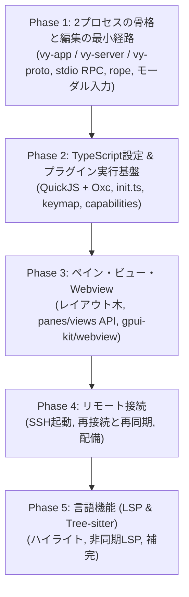

# 実装ロードマップと未決定事項

Vy
は、クライアントとコアを最初から分けて実装します。ローカル接続でも別プロセスにするため（[ADR 0002](./adr/0002-process-model.md)）、Phase
1 で RPC
の骨格を通します。後から分離するのではなく、分離した状態で機能を足します。

---

## 実装フェーズ

### Phase 1: 2プロセスの骨格と編集の最小経路

- [x] `crates/vy-app`、`crates/vy-server`、`crates/vy-proto`、`crates/vy-core`
      の雛形を作る
- [x] クライアントが `vy-server`
      を子プロセスで起動し、標準入出力でフレームを読み書きする
- [x] `initialize` と `initialized` のハンドシェイクを実装する
- [x] `pane/open` で文書を開き、`buffer/snapshot` で本文を受け取って描画する
- [x] `ropey` によるテキストバッファと、`buffer/did_change` のサーバー側の適用
- [x] クライアントからの `buffer/did_change` の送信と、`buffer/resync` の反映
- [x] Helix方式のモーダル入力エンジン:
  - `Selection -> Action`（文字・単語選択後に削除・変更）
  - Normal, Insert, Select モードの基本実装
- [x] カウント（`5j` `5x`）と、`"a`–`"z` のレジスタ、`p` / `P`、`.` の繰り返し
  - `y`（ヤンク）とテキストオブジェクトは、Phase 2 のキーマップで扱う
- [x] 日本語 IME の前編集（`EntityInputHandler`）
  - 前編集の文字列はコアに送らず、クライアントがカーソル位置に描く
- [ ] Phase 1 の検証項目:
  - [x] Linux (Wayland) で起動する。Windows は Phase 1 の対象外とする
  - [ ] macOS で起動する（手元に環境がないため未確認）
  - [ ] 日本語 IME の前編集が、カーソル位置に正しく出る
  - [x] 20万行のファイルを開き、スクロールと入力が引っかからない
    - 実測: 20万行のスナップショットを 7.2 ms で読み込み、1フレームの組み立ては
      0.1–0.4 ms。ホイールで移動できる行は、ファイルの大きさに依存しない
  - [x] `vy-server`
        を終了したとき、クライアントが落ちずに通知を出す。再起動は手動で行う
  - [x] ローカル接続の往復が、入力の遅延として感じられない
    - 入力はクライアントの写しにすぐ反映し、コアの応答を待たない
- [x] ヘッドレスの `cargo test`:
  - `vy-core` のバッファとアンドゥ
  - `vy-server` の RPC の往復と、プロトコルの版が合わないときに接続を閉じること

### Phase 2: TypeScript設定 & プラグイン実行基盤

- [ ] `rquickjs` をクライアントに統合し、Promise を進めるジョブキューを回す
- [ ] `~/.config/vy/init.ts` と `settings.json` の読み込みと反映
- [ ] `vy-api` のシムを作り、`vy-api.d.ts` を Rust の型から生成する
- [ ] コマンドとキーバインドの登録（`commands.registerCommand`、`keymap.bind`）
- [ ] ケイパビリティの宣言と承認の記録（`trusted.json`）
- [ ] 設定の4層の解決（既定値、ユーザー、プロジェクト、`init.ts`）

### Phase 3: ペイン・ビュー・Webview

- [ ] レイアウト木（分割、比率、フォーカス、フローティング）と `panes.*` の API
- [ ] `views.register` と7種類のビュー（`ui` を含む）
- [ ] `ui` ビューのウィジェット木と、キーマップからのアクション解決
- [ ] `gpui-kit/crates/webview` の組み込み
- [ ] Webview を Web 文書の表示に限って開く（Markdown プレビュー等）
- [ ] Jupyter Notebook形式のセル描画・Webview出力
- [ ] スロット（ステータスライン、ピッカー、ホバー、ガター）

### Phase 4: リモート接続

- [ ] SSH 経由で `vy-server` を起動する
- [ ] バイナリの配備方法を決めて実装する
- [ ] 再接続と再同期（`resume_session`、`layout/get`、version の突き合わせ）
- [ ] 遅延の計測と、先読み描画の範囲の調整

### Phase 5: 言語機能 (LSP & Tree-sitter)

- [ ] `tree-sitter` によるシンタックスハイライト
- [ ] エディタ本体での非同期LSPクライアント基盤（プロセス管理・ドキュメント同期）
- [ ] 補完プロバイダー（`registerCompletionProvider`）とローカルファジー絞り込み

---

## 決定済み

先に決めた項目です。詳細は各ドキュメントにあります。

| 決定                   | 内容                                                                               | 記録                                                                             |
| :--------------------- | :--------------------------------------------------------------------------------- | :------------------------------------------------------------------------------- |
| UI フレームワーク      | GPUI と gpui-kit を採用し、依存を `vy-app` に閉じる                                | [ADR 0001](./adr/0001-ui-framework.md)                                           |
| プロセスの構成         | クライアントとコアを常に別プロセスにし、ローカルは子プロセスと標準入出力でつなぐ   | [ADR 0002](./adr/0002-process-model.md)                                          |
| 編集状態の所在         | 本文とアンドゥはコア、カーソルと選択はクライアント                                 | [ADR 0003](./adr/0003-editor-state.md) と [ADR 0004](./adr/0004-undo-in-core.md) |
| 画面の構成             | 固定のサイドバーやパネルを作らず、すべてをペインとして扱う                         | [`panes.md`](./panes.md)                                                         |
| プラグインの信頼モデル | マニフェストでケイパビリティを宣言し、初回に承認する                               | [`plugin-system.md`](./plugin-system.md)                                         |
| 設定の形式             | `init.ts` と `settings.json` の2種類。プロジェクト側は JSON のみ                   | [`plugin-system.md`](./plugin-system.md)                                         |
| API の形               | 名前空間の import と async ファースト                                              | [`api.md`](./api.md)                                                             |
| ファイルの配置         | ユーザー設定、プロジェクト、プラグインのパッケージ規約                             | [`layout.md`](./layout.md)                                                       |
| 通信の拡張             | ハンドシェイク、取り消し、ストリーム、Blob                                         | [`protocol.md`](./protocol.md)                                                   |
| プラグイン UI          | ネイティブのウィジェット木を既定にし、Webview は Web 文書の表示に限る              | [ADR 0005](./adr/0005-native-plugin-ui.md) と [`ui.md`](./ui.md)                 |
| プロセスの起動         | `vy-app` が `vy-server --stdio` を起動し、ワークスペースは `initialize` で渡す     | [`architecture.md`](./architecture.md) と [`protocol.md`](./protocol.md)         |
| 子プロセスの終了       | クライアントは落とさず通知だけ出す。自動では再起動せず、手動で行う                 | [`architecture.md`](./architecture.md)                                           |
| フレームの形式         | 長さはリトルエンディアンの u32。上限 64 MiB。読み書きは各1本のスレッドに固定       | [`protocol.md`](./protocol.md)                                                   |
| 実行基盤               | `vy-server` は tokio、`vy-core` は同期のまま。`vy-app` は専用スレッドで RPC を扱う | [`architecture.md`](./architecture.md)                                           |
| 位置の内部表現         | コアは ropey の char index で持ち、境界で UTF-16 と UTF-8 に変換する               | [`architecture.md`](./architecture.md)                                           |
| アンドゥのまとめ       | モード変更、500ms の入力間隔、選択を伴うコマンドで区切る                           | [`protocol.md`](./protocol.md)                                                   |
| Phase 1 の対象 OS      | Linux と macOS。Windows は Phase 1 の対象外                                        | [`roadmap.md`](./roadmap.md)                                                     |

## 残っている論点

1. **多言語サポートとTree-sitterパーサーの管理**
   - 主要言語のパーサーを最初からバイナリに組み込むか、必要に応じて取得するか。クエリの上書きをどこまで許すかも未定です。
2. **補完プロバイダの実行場所**
   - 入力の遅延を抑えるならクライアント、言語サーバーに近い方がよければリモートです。
3. **プラグインの配布**
   - レジストリを作るか、Git のリポジトリ指定だけで済ませるか。Phase 5
     以降に決めます。
4. **先読み描画の範囲**
   - リモート接続で入力の遅延を隠すため、クライアントがどこまで先に描くか。
5. **`vy-server` の多重化と配備**
   - 1プロセスで複数のワークスペースを持つか。SSH
     接続でバイナリをどう用意するか。
