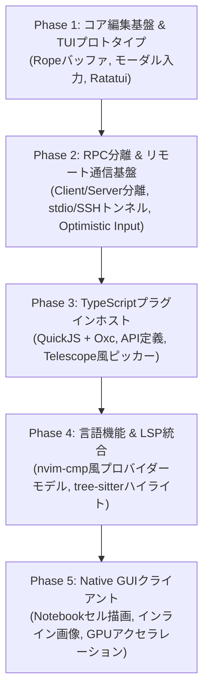

# 実装ロードマップ & 未決定事項 (TODO)

Vy の開発計画と、今後議論・決定していく技術的課題のリストです。

---

## 🗺️ 実装フェーズ

### Phase 1: コア編集基盤 & TUIプロトタイプ
- [ ] `crates/vy-core`: `ropey` によるバッファ管理の実装
- [ ] 基本的なモード遷移（Normal, Insert, Visual, Command）の実装
- [ ] `crates/vy-tui`: `ratatui` + `crossterm` による単一プロセスでの画面描画
- [ ] 基本的なテキストオブジェクトと移動コマンド

### Phase 2: RPC分離 & リモート通信基盤
- [ ] Core を独立したライブラリ/サーバーバイナリとして分離
- [ ] ローカル内部チャネルによるクライアント-サーバー通信の実装
- [ ] SSH経由のstdioリモート接続（`vy ssh user@host`）の実装
- [ ] 入力遅延を吸収するローカル先行入力（Optimistic UI）の検証

### Phase 3: TypeScriptプラグインホスト
- [ ] `crates/vy-plugin`: `rquickjs` の組み込み
- [ ] `oxc_transform` による `.ts` の即時トランスパイル・ローダーの実装
- [ ] TypeScript型定義（`vy-api.d.ts`）の整備
- [ ] **マイルストーン**: `telescope.ts`（ripgrep検索 + フローティングウィンドウ）の動作実証

### Phase 4: 言語機能 & LSP統合
- [ ] LSP (Language Server Protocol) クライアントの実装
- [ ] 補完プロバイダー（`registerCompletionProvider`）とローカルファジー絞り込み
- [ ] `tree-sitter` によるシンタックスハイライト

### Phase 5: Native GUIクライアント (リッチUI)
- [ ] GUIフロントエンドの実装（TUIと同じRPCプロトコルで接続）
- [ ] Jupyter Notebook風のセル分割・実行結果表示
- [ ] 画像やプロットのインライン描画

---

## ❓ これから決めること (未決定事項リスト)

開発を進める中で、段階的に検討・決定していく項目です。

### 1. 設定ファイル (Config) のフォーマット
- **候補 A: TOML / KDL** (静的・シンプル。キーバインドや外観の基本設定向け)
- **候補 B: TypeScript / JS** (VS Codeのsettings.jsonやNeovimのinit.luaのように、設定ファイル自体をTSで書く)
- **現在のステータス**: 未定。基本設定はTOML、動的なスクリプト拡張はTypeScriptとするハイブリッドを検討。

### 2. キーバインド仕様の厳密さ (Vim互換性の範囲)
- どこまで Vim のマクロ (`qa`) やレジスタ (`"a`)、エクスモード (`:`) を忠実に再現するか？
- Helix のような「選択 → アクション」寄りの設計を取り入れるか？
- **現在のステータス**: 未定。コアのキーバインドエンジン設計時に検討。

### 3. GUI描画エンジンのフレームワーク選定
- **候補 A: GPUI** (Zedエディタが開発した高速GPUベースのUIフレームワーク)
- **候補 B: WGPU + Vello / Piet** (Rust標準的なGPU描画スタック)
- **候補 C: Iced / egui** (実績のあるRust製GUIフレームワーク)
- **現在のステータス**: 未定。Phase 4完了後、GUIクライアント着手時に各フレームワークの成熟度とNotebook描画適性を比較して決定。

### 4. プラグインの配布・エコシステム
- プラグインのインストール方法（Git URL指定、マニフェストファイル管理、あるいは専用レジストリ）。
- **現在のステータス**: 未定。Phase 3でローカルディレクトリ読み込みから始め、その後に仕様策定。
