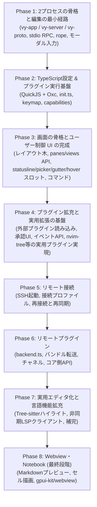

# 実装ロードマップと未決定事項

Vy
は、クライアントとコアを最初から分けて実装します。ローカル接続でも別プロセスにするため（[ADR 0002](./adr/0002-process-model.md)）、Phase
1 で RPC
の骨格を通します。後から分離するのではなく、分離した状態で機能を足します。

---

## 実装フェーズ

画面の骨格を早く固めるため、ペインとビュー、ユーザー制御 UI スロット群を Phase 3
で完成させます。 Phase 4 では外部プラグインのマニフェスト読み込みや承認
UI、エディタ・ワークスペースイベントを整備し、`nvim-tree`
のようなファイラーをはじめとする実用プラグインを実際に実装できるようにします。
Phase 5 で SSH 接続と再接続・再同期を通し、Phase 6 で接続先で動く
`backend.ts` とチャネルを実装します。言語機能は、リモートでも同じ経路で検証できる
状態になってから Phase 7 で拡充します。Webview と Notebook は最後の手段として
Phase 8 で扱います。

### Phase 1: 2プロセスの骨格と編集の最小経路

- [x] `crates/vy-app`、`crates/vy-server`、`crates/vy-proto`、`crates/vy-core`
      の雛形を作る
- [x] クライアントが `vy-server`
      を子プロセスで起動し、標準入出力でフレームを読み書きする
- [x] `initialize` と `initialized` のハンドシェイクを実装する
- [x] `pane/open` で文書を開き、`buffer/snapshot` で本文を受け取って描画する
- [x] `ropey` によるテキストバッファと、`buffer/did_change` のサーバー側の適用
- [x] クライアントからの `buffer/did_change` の送信と、`buffer/resync` の反映
- [x] Helix方式のモーダル入力エンジン:
  - `Selection -> Action`（文字・単語選択後に削除・変更）
  - Normal, Insert, Select モードの基本実装
- [x] カウント（`5j` `5x`）と、`"a`–`"z` のレジスタ、`p` / `P`、`.` の繰り返し
  - `y`（ヤンク）とテキストオブジェクトは、Phase 2 のキーマップで扱う
- [x] 日本語 IME の前編集（`EntityInputHandler`）
  - 前編集の文字列はコアに送らず、クライアントがカーソル位置に描く
- [ ] Phase 1 の検証項目:
  - [x] Linux (Wayland) で起動する。Windows は Phase 1 の対象外とする
  - [ ] macOS で起動する（手元に環境がないため未確認）
  - [x] 日本語 IME の前編集が、カーソル位置に正しく出る
  - [x] 20万行のファイルを開き、スクロールと入力が引っかからない
    - 実測: 20万行のスナップショットを 7.2 ms で読み込み、1フレームの組み立ては
      0.1–0.4 ms。ホイールで移動できる行は、ファイルの大きさに依存しない
  - [x] `vy-server`
        を終了したとき、クライアントが落ちずに通知を出す。再起動は手動で行う
  - [x] ローカル接続の往復が、入力の遅延として感じられない
    - 入力はクライアントの写しにすぐ反映し、コアの応答を待たない
- [x] ヘッドレスの `cargo test`:
  - `vy-core` のバッファとアンドゥ
  - `vy-server` の RPC の往復と、プロトコルの版が合わないときに接続を閉じること
- [x] キーの一覧と実装状況を [`keymap.md`](./keymap.md) にまとめる

### Phase 2: TypeScript設定 & プラグイン実行基盤

- [x] `rquickjs` をクライアントに統合し、Promise を進めるジョブキューを回す
- [x] `~/.config/vy/init.ts` と `settings.json` の読み込みと反映
  - `settings.json` の 4 層（既定値、ユーザー、プロジェクト、メモリ）と
    `init.ts` の評価・再評価を実装した
- [x] プラグイン API のシムを作り、型を Rust の型から生成する
  - シムは `crates/vy-js/src/shim.ts` から生成した `generated/shim.js`。プロトコル境界の型は Specta で
    `packages/vy-api/types` に生成し、名前空間の API は `#[vy_api_trait]`
    の宣言から生成する（[ADR 0023](./adr/0023-specta-api-types.md)）
- [x] プラグイン API をグローバル `vy` に移行する（[ADR 0019](./adr/0019-global-vy-api.md)）
- [x] `init.ts` の相対 TypeScript import を実装する
- [x] ソース形態の TS プラグインと相対 import を実装する（[ADR 0020](./adr/0020-plugin-source-and-bundles.md)）
- [x] コマンドとキーバインドの登録（`commands.registerCommand`、`keymap.bind`）
  - Rust 側のコマンドレジストリ、キーマップ、既定キーマップ、`y`
    とテキストオブジェクトを実装した
  - `init.ts` からの登録はスクリプトホスト経由で動く
- [ ] ケイパビリティの宣言と承認の記録（`trusted.json`）
  - `vy-capabilities` にパース、glob 照合、`trusted.json`
    の読み書きを実装した。マニフェストの読み込みと承認 UI は Phase 4
- [x] 設定の4層の解決（既定値、ユーザー、プロジェクト、`init.ts`）

#### Phase 2 の進捗

- 2-0: undo/redo のバッチ化（`PROTOCOL_VERSION` 2）、RPC
  の書き込みスレッド、受信のイベント駆動化
- 2A: `vy-app` を lib と bin に分割し、設定・キーマップ・コマンドを GPUI
  非依存にした
- 2B: `paths` と `config`（4 層、`ui.*` の反映、mtime 監視）
- 2C: `keymap`（キー列、`when`、カウント、レジスタ、タイムアウト）と `commands`
- 2D: `vy-js`（QuickJS の専用スレッド、Oxc による型の除去、API シム、
  `init.ts` の評価と再評価）と `vy-capabilities`
- 2E: `y` / `Y`、演算子 `d` /
  `y`、テキストオブジェクト、行単位レジスタ、単語クラス
- 2F: ts-rs による `packages/vy-api/types` の生成、
  `packages/vy-api/index.d.ts`、`examples/init.ts`、ドキュメント
- 残り: 外部プラグインのマニフェスト、承認 UI、`activationEvents`、イベント
  API（Phase 4）

### Phase 3: 画面の骨格とユーザー制御 UI の完成

- [x] レイアウト木（分割、フォーカス）と `pane/open` / `pane/focus` /
      `pane/close` / `layout/get`
  - `layout/did_change`
    で確定した木を送る。比率の動的変更（`pane/resize`、境界のドラッグ、キーバインド）に対応。フローティングはまだ無い
- [x] 同じバッファを複数のペインで開く（マルチバッファ）と、ペインごとのカーソル・選択・スクロール
  - モードと IME の前編集もペインごと。最後の選択範囲は文書ごとに `g v`
    で復元できる
- [x] `editor.open`（`:e`）
- [x] `document.save`（`:w`）
- [x] ペイン・ビュー・文書の操作を組み込みコマンドとして公開する
  - `vy.pane.split_right` (`:vsp`)、`vy.pane.split_down`
    (`:sp`)、`vy.pane.close` (`:q`)、 `vy.pane.focus_*`、`vy.pane.next`
- [x] 開いている文書の一覧・切り替え
  - `vy.editor.switch_document`、Ex コマンド（`:b` /
    `:buffer`）、ドキュメントピッカーモーダルによるファジー検索と切り替え
- [x] `views.register`
      と6種類のビュー（`editor`、`ui`、`list`、`text`、`image`、`terminal`）
  - `views.register` と `ui` 名前空間による宣言的ウィジェット木（column, row,
    stack, text, button, textInput 等）の基盤を実装。`webview` は Phase 8
- [x] `ui` ビューのウィジェット木と、キーマップからのアクション解決
  - GPUI によるネイティブウィジェット描画とコマンドバインド対応
- [x] ユーザー制御 UI
      とスロット（[ADR 0006](./adr/0006-user-controlled-ui-and-slots.md)）
  - [x] 固定ヘッダー・フッター・外枠余白の全廃と画面全域の利用
  - [x] グローバルステータスライン（`ui.statusline`）と標準 Vim
        相当の最小既定表示
  - [x] ピッカー（`ui.picker`、`ui.picker.show`）
  - [ ] ピッカーのソース登録（`ui.picker.registerSource`。ホストから提供関数を呼ぶ経路ができるまで保留）
  - [x] ガター（`ui.gutter`、行横のマークやサイン表示スロット）
  - [x] ホバー（`ui.hover`、カーソル行桁へのポップアップ表示スロット）
- [x] コマンド実行の仕上げ
  - [x] `commands.getCommands` に組み込みのペインコマンドを含める
  - [x] `commands.execute` からペインコマンドを実行する
  - [x] `commands.execute` の戻り値を JS へ返す
  - [x] 実行キュー（実行中のコマンドを直列に進める）
  - [x] コマンドパレット（`space` リーダー、単語検索、選択、実行）
  - [x] コマンド記述子と `Invocation`
        の共通化（キーマップ、パレット、Ex、スクリプト）
  - [x] `:` の Ex コマンドライン（[`commands.md`](./commands.md)）
  - [x] ピッカー API（`ui.picker.show`）

### Phase 4: プラグイン拡充と実用拡張の基盤

外部プラグインの導入と実用的なプラグイン（`nvim-tree`
風のファイラー、Git、ステータス拡張など）を実装・動作させられる基盤を整えます。

- [x] 外部プラグインのマニフェスト読み込みと初回の承認 UI（`trusted.json`
      の対話的承認）
- [x] `activationEvents` による遅延読み込み（`onView:xxx`、`onCommand:xxx`）
- [x] エディタとワークスペースのイベント通知 API
  - `editor.onDidChangeSelection`、`editor.onDidChangeActiveEditor`
  - `workspace.onDidChangeWorkspaceFolders`
- [x] プロセス実行とファイルシステムアクセスの API 拡張（`fs.*`、`process.*`）
- [x] プラグインごとに QuickJS ランタイムを分ける（グローバル `vy` の前提）
- [x] ソース形態の TS プラグイン（相対 import、ルート制限、リロード）を実装する
      （[ADR 0020](./adr/0020-plugin-source-and-bundles.md)）
- [x] バンドル形態のロード時検証（残った import、サイズ、SHA-256）を実装する
      （[ADR 0021](./adr/0021-bundle-validation.md)）
- [x] 実用プラグインの検証
  - サイドバー的なツリービューペイン（`views.register` と `ui`
    ウィジェット木を用いた `nvim-tree`
    相当のファイルエクスプローラー）の実装と検証

### Phase 5: リモート接続

ローカルと同じ RPC を SSH の標準入出力で流し、接続が切れても作業を続けられる
ようにします。方式は [ADR 0010](./adr/0010-remote-connection.md) に記録しました。

- [x] Transport をローカルと SSH で切り替えられるようにする
- [x] `~/.config/vy/connections.json` と `vy-app --connect <name>` を追加する
- [x] SSH 経由で導入済みの `vy-server` を起動する
- [x] 接続先の workspace を `initialize` で渡し、`file:` URI を不透明に扱う
- [x] コアがワークスペースごとにレイアウトと開いていた文書を保存する
- [x] 再接続と再同期（`layout/get`、`sync/request`、version の突き合わせ）
- [x] 未保存の本文をクライアントから復元する
- [ ] 遅延の計測と、先読み描画の範囲の調整

### Phase 6: リモートプラグイン

`backend.ts` を接続先のコアで動かし、フロントとはチャネルで通信します。API と
配布の方式は [ADR 0011](./adr/0011-backend-plugins-on-core.md) に記録しました。

- [ ] `vy-server` に `vy-js` を組み込み、プラグインごとにランタイムを作る
- [ ] `plugin/load`、`plugin/unload`、`plugin/message` を実装する
- [ ] バンドルのハッシュとサイズを検証し、メモリにキャッシュする
- [ ] `backend.connect` と `backend.registerHandler` を実装する
- [ ] `workspace`、文書、`fs`、`process`、`config`、`log` のコア側 API を実装する
- [ ] コア側でケイパビリティを検査し、実行時間とメモリを制限する
- [ ] backend 用の型を分け、UI 系の API を出さない（[ADR 0019](./adr/0019-global-vy-api.md)
      で延期した分）
- [ ] 検索プラグインを参照実装として動かす

### Phase 7: 実用エディタ化と言語機能拡充

エディタを本格的に日常利用できるようにするための言語機能と言語サーバー連携を実装します。

- [ ] `tree-sitter` によるシンタックスハイライト
- [ ] エディタ本体での非同期LSPクライアント基盤（プロセス管理・ドキュメント同期）
- [ ] 補完プロバイダー（`registerCompletionProvider`）とローカルファジー絞り込み
- [ ] 診断表示（Diagnostics）とガター・ホバー連携
- [ ] 定義ジャンプ・参照検索・フォーマット

### Phase 8: Webview・Notebook (最終段階)

Webview は Web の文書そのものを表示するときだけ使います。操作を伴う UI は Phase
3 の `ui` ビューで作ります（[`ui.md`](./ui.md)）。

- [ ] `gpui-kit/crates/webview` の組み込み
- [ ] Webview のフォーカス、キー入力、テーマの受け渡し
- [ ] Webview を Web 文書の表示に限って開く（Markdown プレビュー等）
- [ ] Jupyter Notebook 形式のセル描画と Webview 出力

## UI・エディタの改善バックログ

機能追加ではなく、すでにある画面と編集の正しさ、使い勝手、性能を上げる作業です。
優先度は P0（不具合・データの危険）、P1（表示と操作の質）、P2（性能・保守）です。
各項目には実装の入口になるファイルを添えています。着手したらチェックを付けます。

### P0: 正しさと安全性

- [x] 未保存の文書を閉じるときに確認する。`vy.pane.close` はそのまま
      `pane/close` を送り、コアは最後のペインと一緒に文書を破棄します。ウィンドウを
      閉じたときの確認もありません（`crates/vy-app/src/view/commands.rs` の
      `close_active_pane`、`crates/vy-server/src/session/pane.rs` の `close_pane`）。
      `:q!` も未実装です。
- [x] 列を UTF-16 コード単位ではなく表示セルで数える。折り返しの幅、横スクロール、
      ホバーの x 座標が 1 文字 = 1 セルの前提で、全角文字やタブでは実際の描画幅と
      合いません（`crates/vy-app/src/text_layout.rs` の `chunk_line` と
      `scroll_to_show_horizontal`、`crates/vy-app/src/ui/pane.rs`、
      `crates/vy-app/src/view/render.rs` のホバー）。
- [x] IME の候補ウィンドウの位置を、横スクロール、折り返し、サブ行を考慮して返す。
      `bounds_for_range` はスクロール量を見ず、`character_index_for_point` は常に
      `None` を返します（`crates/vy-app/src/view/input.rs`）。Phase 1 の
      「日本語 IME の前編集が、カーソル位置に正しく出る」も未チェックのままです。
- [x] パレットと Ex コマンドラインで IME の前編集を使えるようにする。どちらも
      キーイベントで文字を積むため、日本語の入力と検索ができません
      （`crates/vy-app/src/view/commands.rs`、`crates/vy-app/src/view/input.rs`、
      [`keymap.md`](./keymap.md)）。
- [ ] （保留・スキップ）`session.json` を実装する。文書ではウィンドウの大きさ、スクロール位置、
      フォーカスの履歴をクライアントが保存すると決めていますが、書くコードが
      ありません。ウィンドウは 1000x700 で固定です（[`panes.md`](./panes.md)、
      [`layout.md`](./layout.md)、`crates/vy-app/src/main.rs`）。今回の改善では保留とします。

### P1: 表示と操作の質

- [x] カーソルの見た目: 点滅、Select 系のカーソル、現在行のハイライト
      （`crates/vy-app/src/ui/pane.rs`、`crates/vy-app/src/theme.rs`）。
- [x] ステータスライン: 長いパスの切り詰め。今は省略や `overflow` の指定がなく、長い URI は
      折り返すか、右側の項目にはみ出します（`crates/vy-app/src/ui/statusline.rs`）。
- [x] 通知: 自動消去と重なりの扱い。`notifications.show` は `message` だけを受け取り、
      状態行に置くだけで消えません（`crates/vy-app/src/api/host/notifications.rs`、
      [`api.md`](./api.md)）。
- [x] テーマ: 起動時に `Theme::dark()` を固定しています。`Theme::light()` を設定から
      選べるようにし、切り替え時に再描画します（`crates/vy-app/src/main.rs`、
      `crates/vy-app/src/theme.rs`）。
- [x] タブ: タブを 1 列として折り返しています。表示セル幅の計算と合わせて、
      `tabstop`（既定値を決める）で描くようにします（`crates/vy-app/src/text_layout.rs`、
      [`keymap.md`](./keymap.md)）。
- [x] ガター: 実測した文字幅とずれないようにし、1 行に複数のマークを描く。今は
      近似幅を使い、`marks.first()` で 1 つだけ描きます
      （`crates/vy-app/src/ui/pane.rs`）。
- [x] ホバー: 折り返しのサブ行と全角幅を考慮した位置に出す
      （`crates/vy-app/src/view/render.rs`）。
- [x] 横スクロール: 行の長さで上限を決め、文書の切り替えや再同期で 0 に戻す。
      `reset_views_for_document` は `scroll_top` だけ戻します
      （`crates/vy-app/src/text_layout.rs`、`crates/vy-app/src/view/mod.rs`）。

### P2: 性能と保守

- [x] フレームごとの `Config` と `Theme` の clone をやめ、共有参照か `Arc` にする
      （`crates/vy-app/src/ui/pane.rs` の `prepare_editor_paint`、
      `crates/vy-app/src/view/render.rs`）。
- [x] 折り返し時の `chunk_line` と行長の計算を、可視行だけ、差分、キャッシュにする。
      長い 1 行のファイルでは毎フレーム O(行長) になります
      （`crates/vy-app/src/ui/pane.rs`、`crates/vy-app/src/view/mod.rs`）。
- [x] 文字幅の測定結果をフォント設定ごとにキャッシュする。`font_character_width` は
      毎フレーム呼ばれます（`crates/vy-app/src/ui/pane.rs`）。
- [x] アクセシビリティ: 読み上げ、キーボードだけでのフォーカス移動、フォーカス順
      （[`ui.md`](./ui.md) の未決定事項）。`Esc` のフォーカス層も決めます
      （[`keymap.md`](./keymap.md)）。
- [x] ドキュメントを実装に追いつかせる: [`panes.md`](./panes.md) の実装状況は
      `editor` ビューだけのまま、[`keymap.md`](./keymap.md) は Phase 2 のまま。
      `editor.wrap`、`:set wrap`、Settings パレットは README と
      [`commands.md`](./commands.md) に載せた。

### 機能追加として別に扱うもの

次は改善ではなく機能追加なので、このバックログには入れません。予定は各文書にあります。

- マウス操作（クリックでフォーカスとカーソル移動、ドラッグで選択、ポインタ下の
  ペインのホイール）: [`keymap.md`](./keymap.md)
- フローティングペイン: [`panes.md`](./panes.md)
- ペインごとのステータスラインと、項目のクリック実行: [`ui.md`](./ui.md)
- システムのクリップボードと `"+` / `"*`: [`keymap.md`](./keymap.md)
- 未実装の編集キー（`Delete`、`Ctrl-w`、`Ctrl-r`、`Ctrl-e` / `Ctrl-y` など）:
  [`keymap.md`](./keymap.md) の「編集・移動・検索（未実装）」

次に着手するなら、未保存の確認、表示セル幅、パレットと Ex の IME、
ホバーと横スクロールの状態の順です（`session.json` は保留）。前の 3 つは正しさに直結し、後ろの 2 つは
表示のずれをまとめて直します。

---

## 決定済み

先に決めた項目です。詳細は各ドキュメントにあります。

| 決定                   | 内容                                                                                | 記録                                                                               |
| :--------------------- | :---------------------------------------------------------------------------------- | :--------------------------------------------------------------------------------- |
| UI フレームワーク      | GPUI と gpui-kit を採用し、依存を `vy-app` に閉じる                                 | [ADR 0001](./adr/0001-ui-framework.md)                                             |
| プロセスの構成         | クライアントとコアを常に別プロセスにし、ローカルは子プロセスと標準入出力でつなぐ    | [ADR 0002](./adr/0002-process-model.md)                                            |
| 編集状態の所在         | 本文とアンドゥはコア、カーソルと選択はクライアント                                  | [ADR 0003](./adr/0003-editor-state.md) と [ADR 0004](./adr/0004-undo-in-core.md)   |
| 画面の構成             | 固定のサイドバーやパネルを作らず、すべてをペインとして扱う                          | [`panes.md`](./panes.md)                                                           |
| プラグインの信頼モデル | マニフェストでケイパビリティを宣言し、初回に承認する                                | [`plugin-system.md`](./plugin-system.md)                                           |
| 設定の形式             | `init.ts` と `settings.json` の2種類。プロジェクト側は JSON のみ                    | [`plugin-system.md`](./plugin-system.md)                                           |
| API の形               | グローバル `vy` と async ファースト                                                 | [ADR 0019](./adr/0019-global-vy-api.md)                                            |
| プラグインの形態       | ソース（相対 TS のみ、依存なし）とバンドル（単一 ESM、依存同梱）                    | [ADR 0020](./adr/0020-plugin-source-and-bundles.md)                                |
| プラグインのビルド     | esbuild などの JS ツールチェーンに任せ、Vy はロード時に検証する                     | [ADR 0020](./adr/0020-plugin-source-and-bundles.md)                                |
| ファイルの配置         | ユーザー設定、プロジェクト、プラグインのパッケージ規約                              | [`layout.md`](./layout.md)                                                         |
| 通信の拡張             | ハンドシェイク、取り消し、ストリーム、Blob                                          | [`protocol.md`](./protocol.md)                                                     |
| プラグイン UI          | ネイティブのウィジェット木を既定にし、Webview は Web 文書の表示に限る               | [ADR 0005](./adr/0005-native-plugin-ui.md) と [`ui.md`](./ui.md)                   |
| プロセスの起動         | `vy-app` が `vy-server --stdio` を起動し、ワークスペースは `initialize` で渡す      | [`architecture.md`](./architecture.md) と [`protocol.md`](./protocol.md)           |
| 子プロセスの終了       | クライアントは落とさず通知だけ出す。自動では再起動せず、手動で行う                  | [`architecture.md`](./architecture.md)                                             |
| フレームの形式         | 長さはリトルエンディアンの u32。上限 64 MiB。読み書きは各1本のスレッドに固定        | [`protocol.md`](./protocol.md)                                                     |
| 実行基盤               | `vy-server` は tokio、`vy-core` は同期のまま。`vy-app` は専用スレッドで RPC を扱う  | [`architecture.md`](./architecture.md)                                             |
| 位置の内部表現         | コアは ropey の char index で持ち、境界で UTF-16 と UTF-8 に変換する                | [`architecture.md`](./architecture.md)                                             |
| アンドゥのまとめ       | モード変更、500ms の入力間隔、選択を伴うコマンドで区切る                            | [`protocol.md`](./protocol.md)                                                     |
| Phase 1 の対象 OS      | Linux と macOS。Windows は Phase 1 の対象外                                         | [`roadmap.md`](./roadmap.md)                                                       |
| アンドゥの結果         | 履歴をバッチで保持し、undo は LIFO、redo は FIFO。`edits` はバッチの配列            | [`protocol.md`](./protocol.md)                                                     |
| クライアントの RPC     | 書き込みは専用スレッド、受信はイベント駆動（16ms ポーリングをやめる）               | [`architecture.md`](./architecture.md)                                             |
| キーマップの状態       | カウントとレジスタはキーマップのプレフィックス。コマンドへ引数で渡す                | [`keymap.md`](./keymap.md)                                                         |
| レジスタの種類         | 文字単位と行単位を持ち、`p` / `P` は行単位をそのまま貼る                            | [`keymap.md`](./keymap.md)                                                         |
| 単語の区切り           | 空白・単語文字（英数字と `_`）・句読点の 3 種類                                     | [`keymap.md`](./keymap.md)                                                         |
| JS の実行              | プラグインごとの専用ランタイム。API はグローバル `vy`。UI とは要求と応答で通信      | [ADR 0019](./adr/0019-global-vy-api.md)                                            |
| TypeScript の変換      | Oxc で型だけを除去する。構文の変換はせず、位置付きのエラーを返す                    | [`plugin-system.md`](./plugin-system.md)                                           |
| モジュール解決         | ソース形態は相対 import のみ。外部依存はバンドルし、実行時に `node_modules` を解決しない | [ADR 0020](./adr/0020-plugin-source-and-bundles.md)                                |
| `init.ts` の信頼       | `init.ts` は常に信頼する。外部プラグインの承認は Phase 4                            | [`plugin-system.md`](./plugin-system.md)                                           |
| 型定義の生成           | プロトコル境界の型は Specta で `bindings.ts` に生成（[ADR 0023](./adr/0023-specta-api-types.md)） | [`api.md`](./api.md)                                                               |
| コマンドの入口         | パレットは発見、Ex は指定、キーは反復。メタデータは記述子に集約し、設定は状態として分離する | [ADR 0022](./adr/0022-command-surfaces.md) と [`commands.md`](./commands.md)      |
| リモート接続           | SSH の標準入出力を使い、接続先に導入済みの `vy-server` を起動する                   | [ADR 0010](./adr/0010-remote-connection.md)                                        |
| 再接続                 | サーバーを起動し直し、レイアウトと未保存の本文をクライアントから再同期する          | [ADR 0010](./adr/0010-remote-connection.md)                                        |
| 接続プロファイル       | `~/.config/vy/connections.json` に置き、`--connect` で選ぶ                          | [ADR 0010](./adr/0010-remote-connection.md)                                        |
| バックエンドプラグイン | `vy-server` で動かし、バンドルはクライアントから送る                                | [ADR 0011](./adr/0011-backend-plugins-on-core.md)                                  |

## 残っている論点

1. **多言語サポートとTree-sitterパーサーの管理**
   - 主要言語のパーサーを最初からバイナリに組み込むか、必要に応じて取得するか。クエリの上書きをどこまで許すかも未定です。
2. **補完プロバイダの実行場所**
   - 入力の遅延を抑えるならクライアント、言語サーバーに近い方がよければリモートです。
3. **プラグインの配布**
   - レジストリを作るか、Git のリポジトリ指定だけで済ませるか。Phase 7
     以降に決めます。
4. **先読み描画の範囲**
   - リモート接続で入力の遅延を隠すため、クライアントがどこまで先に描くか。
5. **`vy-server` の多重化**
   - 1プロセスで複数のワークスペースを持つか。配備は接続先に導入済みの
     バイナリを使うことにしました（[ADR 0010](./adr/0010-remote-connection.md)）。
6. **CRLF と EOL**
   - `document.eol` と改行コードの保持をどこで行うか。Phase 2
     では扱わず、Windows 対応と合わせて決めます。
7. **コマンドの入口と設定の細部**
   - 最後のペインでの `:q`、プラグインの Ex 名、履歴の永続化、範囲の既定値などは
     [`commands.md`](./commands.md) の「未決定事項」にまとめました。
8. **Web API のプリミティブ**
   - `console`、`TextEncoder`、`setTimeout` などをどこまで提供するか。外部
     ライブラリの互換性に直結するため、ソース形態とバンドル形態の運用が固まって
     から決めます。`console` だけは listener の例外処理で使っているため、先に
     最低限の修正を行います。
