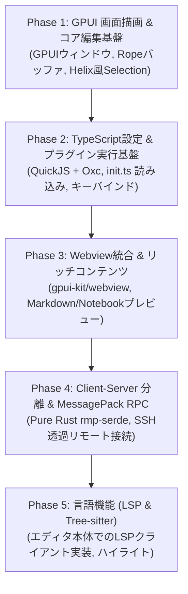

# 実装ロードマップ & 未決定事項

Vy は **「GPUIネイティブGUI最優先」** のアプローチをとるため、ロードマップをGUI中心に再構成しました。

---

## 🗺️ 実装フェーズ

### Phase 1: GPUI 画面描画 & コア編集基盤
- [ ] GPUI による基本ウィンドウとテキスト描画
- [ ] `ropey` によるテキストバッファ管理
- [ ] **Helix方式のモーダル入力エンジン**:
  - `Selection -> Action`（文字・単語選択後に削除・変更）
  - Normal, Insert, Select モードの基本実装

### Phase 2: TypeScript設定 & プラグイン実行基盤
- [ ] `rquickjs` + `oxc_transform` をフロントエンドに統合
- [ ] `~/.config/vy/init.ts` の読み込みと反映
- [ ] TypeScript型定義（`vy-api.d.ts`）の整備
- [ ] キーバインド登録 API (`keymap.bind(...)`)

### Phase 3: Webview統合 & リッチコンテンツ
- [ ] `gpui-kit/crates/webview` の組み込み
- [ ] エディタ横のWebviewペイン分割表示（Markdownプレビュー等）
- [ ] Jupyter Notebook形式のセル描画・Webview出力

### Phase 4: Client-Server 分離 & MessagePack RPC
- [ ] `crates/vy-server` (ヘッドレスコア) の切り出し
- [ ] `rmp-serde` によるバイナリRPC通信の実装
- [ ] SSH経由でのリモートサーバー起動と透過プロキシAPI (`editor.remote.*`)

### Phase 5: 言語機能 (LSP & Tree-sitter)
- [ ] `tree-sitter` によるシンタックスハイライト
- [ ] エディタ本体での非同期LSPクライアント基盤（プロセス管理・ドキュメント同期）
- [ ] 補完プロバイダー（`registerCompletionProvider`）とローカルファジー絞り込み

---

## ❓ これから決めること (未決定事項リスト)

開発を進める中で、段階的に検討・決定していく項目です。

### 1. 多言語サポートとTree-sitterパーサーの管理
- 主要言語（Rust, TS, Python, Go, C/C++等）のパーサーを最初からバイナリに組み込むか、必要に応じて動的ロード（ダウンロード）するか。

### 2. WebviewとGPUIの間のメッセージパッシング仕様
- プラグインがWebview（JavaScript）を開いた際、フロントエンドのQuickJSとWebview内のブラウザJSをどのように通信させるか（VS Codeの `webview.postMessage` スタイルの設計）。

### 3. プラグインの配布・パッケージマネージャ
- プラグインのバージョン管理、GitHubからのインストール機構（`vy plugin install <repo>`）。
