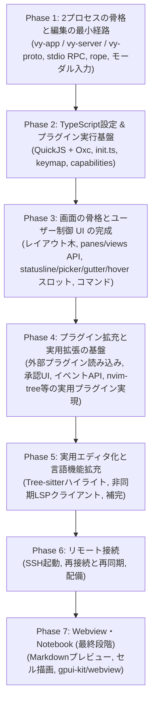

# 実装ロードマップと未決定事項

Vy
は、クライアントとコアを最初から分けて実装します。ローカル接続でも別プロセスにするため（[ADR 0002](./adr/0002-process-model.md)）、Phase
1 で RPC
の骨格を通します。後から分離するのではなく、分離した状態で機能を足します。

---

## 実装フェーズ

画面の骨格を早く固めるため、ペインとビュー、ユーザー制御 UI スロット群を Phase 3 で完成させます。
Phase 4 では外部プラグインのマニフェスト読み込みや承認 UI、エディタ・ワークスペースイベントを整備し、`nvim-tree` のようなファイラーをはじめとする実用プラグインを実際に実装できるようにします。
Phase 5 では Tree-sitter と LSP による言語機能を拡充して日常的に使える実用エディタに仕上げます。
Phase 6 でリモート接続（SSH起動・再同期）を通し、Webview と Notebook は最後の手段として Phase 7 で扱います。

### Phase 1: 2プロセスの骨格と編集の最小経路

- [x] `crates/vy-app`、`crates/vy-server`、`crates/vy-proto`、`crates/vy-core`
      の雛形を作る
- [x] クライアントが `vy-server`
      を子プロセスで起動し、標準入出力でフレームを読み書きする
- [x] `initialize` と `initialized` のハンドシェイクを実装する
- [x] `pane/open` で文書を開き、`buffer/snapshot` で本文を受け取って描画する
- [x] `ropey` によるテキストバッファと、`buffer/did_change` のサーバー側の適用
- [x] クライアントからの `buffer/did_change` の送信と、`buffer/resync` の反映
- [x] Helix方式のモーダル入力エンジン:
  - `Selection -> Action`（文字・単語選択後に削除・変更）
  - Normal, Insert, Select モードの基本実装
- [x] カウント（`5j` `5x`）と、`"a`–`"z` のレジスタ、`p` / `P`、`.` の繰り返し
  - `y`（ヤンク）とテキストオブジェクトは、Phase 2 のキーマップで扱う
- [x] 日本語 IME の前編集（`EntityInputHandler`）
  - 前編集の文字列はコアに送らず、クライアントがカーソル位置に描く
- [ ] Phase 1 の検証項目:
  - [x] Linux (Wayland) で起動する。Windows は Phase 1 の対象外とする
  - [ ] macOS で起動する（手元に環境がないため未確認）
  - [ ] 日本語 IME の前編集が、カーソル位置に正しく出る
  - [x] 20万行のファイルを開き、スクロールと入力が引っかからない
    - 実測: 20万行のスナップショットを 7.2 ms で読み込み、1フレームの組み立ては
      0.1–0.4 ms。ホイールで移動できる行は、ファイルの大きさに依存しない
  - [x] `vy-server`
        を終了したとき、クライアントが落ちずに通知を出す。再起動は手動で行う
  - [x] ローカル接続の往復が、入力の遅延として感じられない
    - 入力はクライアントの写しにすぐ反映し、コアの応答を待たない
- [x] ヘッドレスの `cargo test`:
  - `vy-core` のバッファとアンドゥ
  - `vy-server` の RPC の往復と、プロトコルの版が合わないときに接続を閉じること
- [x] キーの一覧と実装状況を [`keymap.md`](./keymap.md) にまとめる

### Phase 2: TypeScript設定 & プラグイン実行基盤

- [x] `rquickjs` をクライアントに統合し、Promise を進めるジョブキューを回す
- [x] `~/.config/vy/init.ts` と `settings.json` の読み込みと反映
  - `settings.json` の 4 層（既定値、ユーザー、プロジェクト、メモリ）と
    `init.ts` の評価・再評価を実装した
- [x] `vy-api` のシムを作り、`vy-api.d.ts` を Rust の型から生成する
  - シムは `crates/vy-js/src/shim.js`。プロトコル境界の型は ts-rs で
    `packages/vy-api-types` に生成し、名前空間の API は手書き
- [x] コマンドとキーバインドの登録（`commands.registerCommand`、`keymap.bind`）
  - Rust 側のコマンドレジストリ、キーマップ、既定キーマップ、`y`
    とテキストオブジェクトを実装した
  - `init.ts` からの登録はスクリプトホスト経由で動く
- [ ] ケイパビリティの宣言と承認の記録（`trusted.json`）
  - `vy-capabilities` にパース、glob 照合、`trusted.json`
    の読み書きを実装した。マニフェストの読み込みと承認 UI は Phase 4
- [x] 設定の4層の解決（既定値、ユーザー、プロジェクト、`init.ts`）

#### Phase 2 の進捗

- 2-0: undo/redo のバッチ化（`PROTOCOL_VERSION` 2）、RPC
  の書き込みスレッド、受信のイベント駆動化
- 2A: `vy-app` を lib と bin に分割し、設定・キーマップ・コマンドを GPUI
  非依存にした
- 2B: `paths` と `config`（4 層、`ui.*` の反映、mtime 監視）
- 2C: `keymap`（キー列、`when`、カウント、レジスタ、タイムアウト）と `commands`
- 2D: `vy-js`（QuickJS の専用スレッド、Oxc による型の除去、`vy-api`
  シム、`init.ts` の評価と再評価）と `vy-capabilities`
- 2E: `y` / `Y`、演算子 `d` /
  `y`、テキストオブジェクト、行単位レジスタ、単語クラス
- 2F: ts-rs による `packages/vy-api-types` の生成、
  `packages/vy-api/index.d.ts`、`examples/init.ts`、ドキュメント
- 残り: 外部プラグインのマニフェスト、承認 UI、`activationEvents`、イベント API（Phase 4）

### Phase 3: 画面の骨格とユーザー制御 UI の完成

- [x] レイアウト木（分割、フォーカス）と `pane/open` / `pane/focus` /
      `pane/close` / `layout/get`
  - `layout/did_change` で確定した木を送る。比率の固定分割に対応。フローティング、比率の動的変更はまだ無い
- [x] 同じバッファを複数のペインで開く（マルチバッファ）と、ペインごとのカーソル・選択・スクロール
  - モードと IME の前編集もペインごと。最後の選択範囲は文書ごとに `g v`
    で復元できる
- [x] `editor.open`（`:e`）
- [x] `document.save`（`:w`）
- [x] ペイン・ビュー・文書の操作を組み込みコマンドとして公開する
  - `vy.pane.split_right` (`:vsp`)、`vy.pane.split_down` (`:sp`)、`vy.pane.close` (`:q`)、
    `vy.pane.focus_*`、`vy.pane.next`
- [x] 開いている文書の一覧・切り替え
  - `vy.editor.switch_document`、Ex コマンド（`:b` / `:buffer`）、ドキュメントピッカーモーダルによるファジー検索と切り替え
- [x] `views.register`
      と6種類のビュー（`editor`、`ui`、`list`、`text`、`image`、`terminal`）
  - `views.register` と `ui` 名前空間による宣言的ウィジェット木（column, row, stack, text, button, textInput 等）の基盤を実装。`webview` は Phase 7
- [x] `ui` ビューのウィジェット木と、キーマップからのアクション解決
  - GPUI によるネイティブウィジェット描画とコマンドバインド対応
- [x] ユーザー制御 UI とスロット（[ADR 0006](./adr/0006-user-controlled-ui-and-slots.md)）
  - [x] 固定ヘッダー・フッター・外枠余白の全廃と画面全域の利用
  - [x] グローバルステータスライン（`ui.statusline`）と標準 Vim 相当の最小既定表示
  - [x] ピッカー（`ui.picker`、`ui.picker.show`）
  - [ ] ピッカーのソース登録（`ui.picker.registerSource`。ホストから提供関数を呼ぶ経路ができるまで保留）
  - [x] ガター（`ui.gutter`、行横のマークやサイン表示スロット）
  - [x] ホバー（`ui.hover`、カーソル行桁へのポップアップ表示スロット）
- [x] コマンド実行の仕上げ
  - [x] `commands.getCommands` に組み込みのペインコマンドを含める
  - [x] `commands.execute` からペインコマンドを実行する
  - [x] `commands.execute` の戻り値を JS へ返す
  - [x] 実行キュー（実行中のコマンドを直列に進める）
  - [x] コマンドパレット（`space` リーダー、単語検索、選択、実行）
  - [x] コマンド記述子と `Invocation`
        の共通化（キーマップ、パレット、Ex、スクリプト）
  - [x] `:` の Ex コマンドライン（[`ex-commands.md`](./ex-commands.md)）
  - [x] ピッカー API（`ui.picker.show`）

### Phase 4: プラグイン拡充と実用拡張の基盤

外部プラグインの導入と実用的なプラグイン（`nvim-tree` 風のファイラー、Git、ステータス拡張など）を実装・動作させられる基盤を整えます。

- [x] 外部プラグインのマニフェスト読み込みと初回の承認 UI（`trusted.json` の対話的承認）
- [x] `activationEvents` による遅延読み込み（`onView:xxx`、`onCommand:xxx`）
- [x] エディタとワークスペースのイベント通知 API
  - `editor.onDidChangeSelection`、`editor.onDidChangeActiveEditor`
  - `workspace.onDidChangeWorkspaceFolders`
- [x] プロセス実行とファイルシステムアクセスの API 拡張（`fs.*`、`process.*`）
- [x] 実用プラグインの検証
  - サイドバー的なツリービューペイン（`views.register` と `ui` ウィジェット木を用いた `nvim-tree` 相当のファイルエクスプローラー）の実装と検証

### Phase 5: 実用エディタ化と言語機能拡充

エディタを本格的に日常利用できるようにするための言語機能と言語サーバー連携を実装します。

- [ ] `tree-sitter` によるシンタックスハイライト
- [ ] エディタ本体での非同期LSPクライアント基盤（プロセス管理・ドキュメント同期）
- [ ] 補完プロバイダー（`registerCompletionProvider`）とローカルファジー絞り込み
- [ ] 診断表示（Diagnostics）とガター・ホバー連携
- [ ] 定義ジャンプ・参照検索・フォーマット

### Phase 6: リモート接続

- [ ] SSH 経由で `vy-server` を起動する
- [ ] バイナリの配備方法を決めて実装する
- [ ] 再接続と再同期（`resume_session`、`layout/get`、version の突き合わせ）
- [ ] 遅延の計測と、先読み描画の範囲の調整

### Phase 7: Webview・Notebook (最終段階)

Webview は Web の文書そのものを表示するときだけ使います。操作を伴う UI は Phase
3 の `ui` ビューで作ります（[`ui.md`](./ui.md)）。

- [ ] `gpui-kit/crates/webview` の組み込み
- [ ] Webview のフォーカス、キー入力、テーマの受け渡し
- [ ] Webview を Web 文書の表示に限って開く（Markdown プレビュー等）
- [ ] Jupyter Notebook 形式のセル描画と Webview 出力

---

## 決定済み

先に決めた項目です。詳細は各ドキュメントにあります。

| 決定                   | 内容                                                                                | 記録                                                                               |
| :--------------------- | :---------------------------------------------------------------------------------- | :--------------------------------------------------------------------------------- |
| UI フレームワーク      | GPUI と gpui-kit を採用し、依存を `vy-app` に閉じる                                 | [ADR 0001](./adr/0001-ui-framework.md)                                             |
| プロセスの構成         | クライアントとコアを常に別プロセスにし、ローカルは子プロセスと標準入出力でつなぐ    | [ADR 0002](./adr/0002-process-model.md)                                            |
| 編集状態の所在         | 本文とアンドゥはコア、カーソルと選択はクライアント                                  | [ADR 0003](./adr/0003-editor-state.md) と [ADR 0004](./adr/0004-undo-in-core.md)   |
| 画面の構成             | 固定のサイドバーやパネルを作らず、すべてをペインとして扱う                          | [`panes.md`](./panes.md)                                                           |
| プラグインの信頼モデル | マニフェストでケイパビリティを宣言し、初回に承認する                                | [`plugin-system.md`](./plugin-system.md)                                           |
| 設定の形式             | `init.ts` と `settings.json` の2種類。プロジェクト側は JSON のみ                    | [`plugin-system.md`](./plugin-system.md)                                           |
| API の形               | 名前空間の import と async ファースト                                               | [`api.md`](./api.md)                                                               |
| ファイルの配置         | ユーザー設定、プロジェクト、プラグインのパッケージ規約                              | [`layout.md`](./layout.md)                                                         |
| 通信の拡張             | ハンドシェイク、取り消し、ストリーム、Blob                                          | [`protocol.md`](./protocol.md)                                                     |
| プラグイン UI          | ネイティブのウィジェット木を既定にし、Webview は Web 文書の表示に限る               | [ADR 0005](./adr/0005-native-plugin-ui.md) と [`ui.md`](./ui.md)                   |
| プロセスの起動         | `vy-app` が `vy-server --stdio` を起動し、ワークスペースは `initialize` で渡す      | [`architecture.md`](./architecture.md) と [`protocol.md`](./protocol.md)           |
| 子プロセスの終了       | クライアントは落とさず通知だけ出す。自動では再起動せず、手動で行う                  | [`architecture.md`](./architecture.md)                                             |
| フレームの形式         | 長さはリトルエンディアンの u32。上限 64 MiB。読み書きは各1本のスレッドに固定        | [`protocol.md`](./protocol.md)                                                     |
| 実行基盤               | `vy-server` は tokio、`vy-core` は同期のまま。`vy-app` は専用スレッドで RPC を扱う  | [`architecture.md`](./architecture.md)                                             |
| 位置の内部表現         | コアは ropey の char index で持ち、境界で UTF-16 と UTF-8 に変換する                | [`architecture.md`](./architecture.md)                                             |
| アンドゥのまとめ       | モード変更、500ms の入力間隔、選択を伴うコマンドで区切る                            | [`protocol.md`](./protocol.md)                                                     |
| Phase 1 の対象 OS      | Linux と macOS。Windows は Phase 1 の対象外                                         | [`roadmap.md`](./roadmap.md)                                                       |
| アンドゥの結果         | 履歴をバッチで保持し、undo は LIFO、redo は FIFO。`edits` はバッチの配列            | [`protocol.md`](./protocol.md)                                                     |
| クライアントの RPC     | 書き込みは専用スレッド、受信はイベント駆動（16ms ポーリングをやめる）               | [`architecture.md`](./architecture.md)                                             |
| キーマップの状態       | カウントとレジスタはキーマップのプレフィックス。コマンドへ引数で渡す                | [`keymap.md`](./keymap.md)                                                         |
| レジスタの種類         | 文字単位と行単位を持ち、`p` / `P` は行単位をそのまま貼る                            | [`keymap.md`](./keymap.md)                                                         |
| 単語の区切り           | 空白・単語文字（英数字と `_`）・句読点の 3 種類                                     | [`keymap.md`](./keymap.md)                                                         |
| JS の実行              | クライアントの専用スレッド 1 本。`vy-api` は仮想モジュール。UI とは要求と応答で通信 | [`architecture.md`](./architecture.md) と [`plugin-system.md`](./plugin-system.md) |
| TypeScript の変換      | Oxc で型だけを除去する。構文の変換はせず、位置付きのエラーを返す                    | [`plugin-system.md`](./plugin-system.md)                                           |
| `init.ts` の信頼       | `init.ts` は常に信頼する。外部プラグインの承認は Phase 4                            | [`plugin-system.md`](./plugin-system.md)                                           |
| 型定義の生成           | プロトコル境界の型は ts-rs で生成し、名前空間 API の型は手書き                      | [`api.md`](./api.md)                                                               |
| Ex コマンド            | パレットと同じ実行層を使い、`:` はオーバーレイ。Ex 名は明示的な別名で解決する       | [`ex-commands.md`](./ex-commands.md)                                               |

## 残っている論点

1. **多言語サポートとTree-sitterパーサーの管理**
   - 主要言語のパーサーを最初からバイナリに組み込むか、必要に応じて取得するか。クエリの上書きをどこまで許すかも未定です。
2. **補完プロバイダの実行場所**
   - 入力の遅延を抑えるならクライアント、言語サーバーに近い方がよければリモートです。
3. **プラグインの配布**
   - レジストリを作るか、Git のリポジトリ指定だけで済ませるか。Phase 5
     以降に決めます。
4. **先読み描画の範囲**
   - リモート接続で入力の遅延を隠すため、クライアントがどこまで先に描くか。
5. **`vy-server` の多重化と配備**
   - 1プロセスで複数のワークスペースを持つか。SSH
     接続でバイナリをどう用意するか。
6. **CRLF と EOL**
   - `document.eol` と改行コードの保持をどこで行うか。Phase 2
     では扱わず、Windows 対応と合わせて決めます。
7. **Ex コマンドの細部**
   - 最後のペインでの `:q`、プラグインの別名、履歴の永続化などは
     [`ex-commands.md`](./ex-commands.md) の「未決定事項」にまとめました。
