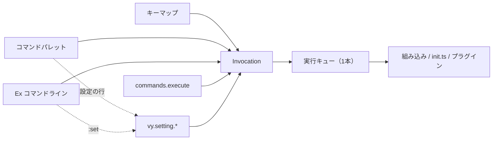

# コマンドと設定

コマンドパレット、Ex コマンドライン、キーマップ、設定の関係をまとめた文書です。
決定の背景は [ADR 0022](../adr/0022-command-surfaces.md) にあります。

- コマンド ID、キーバインド、`commands.execute` の API は [`api.md`](./api.md)
  の「コマンドとキーバインド」「設定」にあります。
- モードごとのキーは [`keymap.md`](./keymap.md) にあります。
- オーバーレイの位置づけは [`ui.md`](./ui.md) と [`panes.md`](./panes.md)
  にあります。

## 1. 全体像

Vy では、操作はすべて**コマンド**です。利用者の入口は3つあり、できることではなく
「どうやってコマンドを選ぶか」が違います。

| 入口                        | 役割                                     | 使う場面                           |
| :-------------------------- | :--------------------------------------- | :--------------------------------- |
| コマンドパレット（`Space`） | 何ができるか分からないときに探す         | 初めて使う操作、たまに使う操作     |
| Ex（`:`）                   | 名前を覚えているとき、正確に指定するとき | 繰り返す編集、範囲指定、スクリプト |
| キーマップ                  | よく使う操作を反復する                   | 移動、編集、ペイン操作             |



設定は入口ではなく**状態**です。状態を変える操作はコマンド（`vy.setting.*`）に
し、`:set` と Settings パレットはそのコマンドを作るフロントエンドにします。

## 2. 入口の比較

| 項目   | コマンドパレット                       | Ex                                 | キーマップ                             |
| :----- | :------------------------------------- | :--------------------------------- | :------------------------------------- |
| 開き方 | `Space`                                | `:`                                | 常時                                   |
| 入力   | 人間向けのタイトルを検索               | `[range] name[!] [args]`           | キー列                                 |
| 引数   | 選択後にプロンプト／ピッカー           | 生文字列を ArgSpec で変換          | キー列の count / register / 任意の引数 |
| 範囲   | 渡さない                               | `range` を渡せる                   | 渡さない                               |
| `!`    | 渡さない                               | コマンドが宣言した場合だけ         | 渡さない                               |
| 補完   | 検索結果の絞り込み                     | コマンド名、設定キー（引数は将来） | なし                                   |
| 履歴   | 最近使ったコマンド（セッション）       | 入力履歴（セッション）             | なし                                   |
| エラー | 入力欄とステータス行                   | ステータス行（将来は `:messages`） | ステータス行                           |

- `Space` と `:` は別の入口のままにします。`Space` がパレット、`:` が Ex で、
  同じキーで両方を開く兼用はしません。ただし、パレットの検索欄が空のときに
  `:` を押すと、パレットを閉じて Ex へ移ります。検索語を入力した後の `:` は
  検索語の一部になります。
- パレットの各行には `:e` のような Ex 名を出します。パレットで見つけた操作を、
  次からは Ex で呼べるようにするためです。
- どの入口も同じ `Invocation` を作り、同じ実行キューとケイパビリティ検査を
  通します。入口を権限の抜け道にしません。

## 3. データモデル

### 3.1 コマンド記述子

コマンドの情報は、コマンド ID を定義する enum と同じ場所
（`crates/vy-client-api/src/command.rs`）に置きます。パレット用と Ex 用の
別テーブルは作りません。

```text
CommandDescriptor
  id: string                    // vy.pane.split_right
  title: string                 // Split Pane Right
  category: CommandCategory     // File / Edit / Selection / View / Pane / App / Settings / Plugin
  palette: listed | hidden      // パレットの一覧に出すか
  ex_names: [string]            // Ex 名。例: ["vsp"]。空でもよい
  args: ArgSpec                 // 引数の形
  range: RangeDefault | none    // 受け付ける範囲。none なら範囲付きの実行を拒否する
  bang: bool                    // `!` を受け付けるか
  source: builtin | pane | ui | init | plugin
```

- 各 enum は網羅 `match` で `meta()` を実装します。variant
  を追加してメタデータを 書き忘れるとコンパイルエラーになります。
- パレット、Ex、`commands.getCommands` は、この記述子だけから生成します。
- `category` は利用者向けの分類です。`source` は実装の出所で、パレットの右側に
  出します。

### 3.2 引数の宣言

```text
ArgSpec := none | positional(Arg[])

Arg
  name: string
  kind: text | path | document | choice(values) | number | any
  required: bool
  rest: bool        // true なら残りの文字列全体を1つの値にする
```

`ArgSpec` は組み込みコマンドの宣言です。実行時は所有権を持つ `ArgList` に変換し、
プラグインが登録した引数も同じ形で扱います。`any` は JSON の値をそのまま渡し、
Ex から入力したときは文字列になります。

引数の集め方は入口ごとに変えますが、変換後の形は同じです。

| 入口               | 入力                            | 変換                                             |
| :----------------- | :------------------------------ | :----------------------------------------------- |
| Ex                 | `name` の後ろの生文字列         | `parse_ex_args` で位置引数に分割し、型を検証する |
| パレット           | 1行プロンプトまたはピッカー     | 位置引数ごとに入力し、型を検証する               |
| `commands.execute` | JSON                            | `ArgSpec` と照合する                             |
| キーマップ         | バインディングの `args`         | `ArgSpec` と照合する                           |

- 単一引数で `rest: true` のときは、残り全体を1つの値にします。
  `:e path with spaces` を壊さないためです。
- 複数引数のときは空白で分割し、`"` と `'` による引用を扱います。
- 必須引数が足りない、未知の引数がある、型が違う場合は、コマンドを実行せずに
  エラーにします。エラーには `usage: :e <path>` のような形を含めます。
- コマンドの実装は生文字列を受け取りません。型付きの値だけを受け取ります。

### 3.3 実行

```text
Invocation
  id: string
  args: CommandArgs { values, count, register }
  range: LineRange | null
  bang: bool
  source: keymap | palette | ex | script
```

- `count` と `register` はキーマップ由来の値です。他の入口では空になります。
- `range` は1始まりの行範囲で、クライアントがアクティブペインの文書を基準に
  解決します。文字位置への変換は、範囲を受け付けるコマンドが行います。
- 実行キューは1本です。実行中のコマンドが終わるまで次を開始しません。
- コマンド ID は `<publisher>.<name>` の形で、組み込みは `vy.` で始まります。 Ex
  名はコマンド ID から自動生成しません。

## 4. コマンドパレット

### 4.1 掲載規則

パレットは「できることの一覧」です。単体で意味が通る利用者向けの操作だけを
`palette: listed` にします。

| カテゴリ | 掲載するコマンド（目標）                                                          |
| :------- | :-------------------------------------------------------------------------------- |
| File     | `vy.editor.open`、`vy.document.save`、`vy.editor.switch_document`                 |
| Edit     | `vy.history.undo`、`vy.history.redo`                                              |
| Pane     | `vy.pane.split_left` / `split_right` / `split_up` / `split_down`、`vy.pane.close` |
| View     | `vy.view.open`、`vy.view.close`、`vy.view.toggle`（プラグインのビュー）           |
| App      | `vy.reconnect_server`                                                             |
| Settings | `vy.ui.open_settings`                                                             |
| Plugin   | マニフェストで公開されたコマンド、`init.ts` が登録したコマンド                    |

次は `palette: hidden` にします。hidden でもキーマップ、スクリプト、
`commands.execute` からは実行できます。

- motion、operator、text object、insert 系、モード切替。キー列の一部として使う
  プリミティブです。
- ペインのフォーカス移動と、ビューのスクロール。キーで反復する操作です。
- 入口そのもの（`vy.ui.command_palette`、`vy.ui.ex_command_line`）。
- 開発向けの `vy.script.eval`。Ex の `:ts` から使えます。
- 内部の糖衣（`vy.view.toggle_wrap`）。パレットには出さず、キーマップから
  使います。
- `vy.setting.set` / `toggle` / `reset`。Settings
  パレットの行が内部的に呼びます。

`vy.editor.open` と `vy.view.open` / `close` / `toggle` は、引数が必須です。
Phase 2 でパレットが選択後に引数を聞くようになったため、これらも listed に
なっています。1行の入力欄を使い、`choice` の引数は候補のピッカーになります。

`vy.view.toggle_wrap` は hidden・Ex 名なしの糖衣です。折り返しは `:set wrap` で
変えます。

### 4.2 表示

- 検索語が空のときは、カテゴリを見出しにし、その下にコマンドを並べます。
- 最近使ったコマンドがあれば、先頭に「Recent」を出します（セッション内、
  最大5件）。Recent に出たコマンドはカテゴリ側には重複して出しません。
- 検索語があるときは見出しを出さず、順位順の平坦なリストにします。
- 1行は「タイトル」「コマンド ID」「Ex 名（無ければ source）」を出します。
- 上部に件数、下部に `Enter run · : for named commands · Esc close` を出します。

### 4.3 検索と操作

| キー              | 動作                                                                 |
| :---------------- | :------------------------------------------------------------------- |
| 文字              | 検索語に追加                                                         |
| `Backspace`       | 検索語を1文字削除                                                    |
| `Up` / `Ctrl-p`   | 前の項目へ                                                           |
| `Down` / `Ctrl-n` | 次の項目へ                                                           |
| `Enter`           | 実行、または引数の入力へ                                             |
| `Esc`             | 閉じる                                                               |
| `:`               | 検索語が空のときだけ、パレットを閉じて Ex を開く（検索語には追加しない） |

検索は空白で区切った語の AND とし、部分一致で絞り込みます。並び順は 「完全一致 →
単語の先頭一致 → 部分一致」、同じ順位ではカテゴリとタイトル順です。完全一致は、
タイトル、コマンド ID、Ex 名のいずれかと一致した場合を指します。

### 4.4 引数の入力

`Enter` を押したときの動作は、コマンドの `ArgSpec` で決まります。

| 引数                              | 動作                                               |
| :-------------------------------- | :------------------------------------------------- |
| なし                              | そのまま実行する                                   |
| 必須の `text` / `path` / `number` | 1行プロンプトを出す                                |
| `choice`                          | 候補のピッカーを出す                               |
| `document`                        | 開いている文書のピッカーを出す                     |
| 任意引数のみ                      | そのまま実行する（引数を足したいときは Ex を使う） |

- プロンプトでは、コマンド名と引数名をラベルに出します。
- `Esc` は実行をやめ、パレットへ戻ります。検索語は保ちます。
- 入力が不正なときは `usage:` を含むエラーをプロンプトに出し、ステータス行にも
  残します。
- パレットの入力は、Ex と同じテキストエンジン（IME の前編集）を使います。

### 4.5 Settings ビュー

パレットの `PaletteMode::Settings` は、設定を一覧して変更します。

- 行は「設定キー」「現在値」「スコープ」「値の出所」を出します。
- 真偽値は `Enter` で切り替えます。列挙はピッカー、数値と文字列は1行プロンプト
  です。
- 変更は `vy.setting.set` / `toggle` を呼びます。Settings ビュー専用の状態は
  持ちません。
- `:set` を引数なしで実行したときも、同じビューを開きます。

## 5. Ex コマンドライン

### 5.1 文法

```text
command_line := ":" [range] name ["!"] [space args]
range        := address | address "," address | "%"
address      := number | "." | "$" | "'<" | "'>" | "+" [number] | "-" [number]
```

| 指定        | 意味                                 |
| :---------- | :----------------------------------- |
| `%`         | 文書全体                             |
| `N`         | N 行目                               |
| `.`         | アクティブペインのカーソル行         |
| `$`         | 最終行                               |
| `N,M`       | N 行目から M 行目                    |
| `'<` `'>`   | 文書ごとに記録した最後の Visual 範囲 |
| `+N` / `-N` | カーソル行からの相対行               |

- 範囲はまず行範囲として解決し、コマンドが受け付ける場合だけ文字位置に変換
  します。
- `range` を宣言していないコマンドに範囲が付いたら、実行せずエラーにします。
- 範囲を実際に使う編集コマンドはまだありません。現在は解析と拒否だけを行います。
- 範囲の既定値はコマンドごとに `range_default` で宣言します。暗黙の既定値は
  置きません。
- `|` による連結、`"` によるコメント、`/pattern/` による範囲指定は初期版では
  扱いません。`:wq` のような組み合わせは1つのコマンドとして登録します。

### 5.2 名前の解決

- Ex 名は小文字の英字、数字、`-` だけにします。
- 完全一致を最優先します。
- 完全一致がなければ、一意に決まる接頭辞を許可します。`:wr` は `:write` に
  解決します。
- 候補が複数ある場合は実行せず、候補を並べます。`:s` は `sp`、`set`、
  `split-left`、`split-up` などが候補になります。
- コマンド ID は Ex 名として使いません。Ex 名は別名として明示的に登録します。
- 組み込みの Ex 名は予約します。プラグインは信頼済みの場合だけ Ex 名を登録
  でき、組み込みと他のプラグインを含めて重複を許しません。衝突したプラグインは
  読み込まず、警告を出します。

### 5.3 引数と `!`

- `name` の後ろの文字列は、先頭の空白を除いて `ArgSpec` に渡します。
- 引数の解釈は共通の `parse_ex_args` が行います。コマンドごとの独自解釈は
  残しません。
- `!` はコマンドが `bang` を宣言した場合だけ渡します。意味はコマンドが決めます
  （例: `:q!` は未保存の変更を捨てる）。
- `bang` のないコマンドに `!` が付いたらエラーにします。

### 5.4 組み込みの Ex 名

| Ex 名             | コマンド ID                                          | 状態                         | 備考                        |
| :---------------- | :--------------------------------------------------- | :--------------------------- | :-------------------------- |
| `:e` / `:edit`    | `vy.editor.open`                                     | 実装済み                     | 引数に URI またはパス       |
| `:w` / `:write`   | `vy.document.save`                                   | 実装済み                     | 別名保存は未対応            |
| `:b` / `:buffer`  | `vy.editor.switch_document`                          | 実装済み                     | 引数なしは文書ピッカー      |
| `:sp`             | `vy.pane.split_down`                                 | 実装済み                     | 上下に分割                  |
| `:vsp`            | `vy.pane.split_right`                                | 実装済み                     | 左右に分割                  |
| `:split-left`     | `vy.pane.split_left`                                 | 実装済み                     | 左に分割                    |
| `:split-up`       | `vy.pane.split_up`                                   | 実装済み                     | 上に分割                    |
| `:close` / `:q`   | `vy.pane.close`                                      | 実装済み                     | 最後のペインは閉じられない  |
| `:view`           | `vy.view.open`                                       | 実装済み                     | プラグインのビューを開く    |
| `:view-close`     | `vy.view.close`                                      | 実装済み                     | ビューを閉じる              |
| `:view-toggle`    | `vy.view.toggle`                                     | 実装済み                     | ビューの表示を切り替える    |
| `:undo` / `:redo` | `vy.history.undo` / `vy.history.redo`                | 実装済み                     | アンドゥとリドゥ            |
| `:reconnect`      | `vy.reconnect_server`                                | 実装済み                     | サーバーへ再接続            |
| `:set`            | `vy.setting.ex_set`（引数なしは Settings パレット）  | 実装済み                     | 設定を変える。次節          |
| `:setglobal`      | `vy.setting.ex_set_global`                           | 実装済み                     | メモリ層の既定値を変える    |
| `:settings`       | `vy.ui.open_settings`                                | 実装済み                     | Settings パレットを開く     |
| `:ts`             | `vy.script.eval`                                     | 実装済み                     | TypeScript を評価（hidden） |
| `:wq`             | `vy.document.write_quit`                             | 未実装                       | 保存と終了を1コマンドにする |
| `:bn` / `:bp`     | `vy.document.next` / `previous`                      | 未実装                       | 文書一覧ができてから        |
| `:noh`            | `vy.search.clear_highlight`                          | 未実装                       | 検索のハイライトを消す      |

`:wrap` は `:set wrap` に統合したため、Ex 名としては存在しません。
`vy.view.toggle_wrap` はキーマップ用の糖衣として残しています。

`!` 付きの強制終了（`:q!`）、シェル実行（`:!`）、`:terminal` は初期版では
扱いません。`:!` は `process:exec` の承認が必要になるため、Ex の権限経路が
固まってから追加します。

### 5.5 補完と履歴

- `Tab` / `Shift-Tab` でコマンド名を補完します。入力中の名前を接頭辞にする Ex 名
  を候補にし、`Tab` は次、`Shift-Tab` は前の候補へ巡回します。候補は入力行の上
  に一覧で出し、選択中の候補を強調します。
- 候補が 1 つなら `Tab` でその名前になります。入力し直すと候補は作り直します。
- 設定名も補完します。`:set wr` は `wrap` に、`:set now` は `nowrap` に、
  `:set theme=l` は `light` になります。設定キーは最後のセグメント（`wrap`）でも
  完全なキー（`editor.wrap`）でも指定できます。
- 引数の補完は `ArgSpec` で宣言します。`choice` は候補、`document` は開いている
  文書、`path` は将来ファイル一覧をコアへ問い合わせます。
- 履歴はセッション内だけ保持します。`Up` / `Down` で移動し、空行と重複は
  正規化します。
- パレットの履歴と Ex の履歴は別に持ちます。

### 5.6 実行とエラー

1. `:` が開き、入力が確定する。
2. Ex パーサーが範囲、名前、`!`、引数を取り出す。
3. 記述子から Ex 名を解決する。
4. `ArgSpec`、`range`、`bang` を照合する。
5. `Invocation` を作り、実行キューへ積む。
6. コマンドが失敗したら `ErrorCode` とメッセージをステータス行へ出す。

- 解析エラー、未知のコマンド、曖昧な名前、未対応の範囲、未宣言の `!` は、
  コマンドを実行せずにエラーにします。
- コマンドの実行中は入力を待たせ、二重実行を防ぎます。
- エラーは英語のメッセージと安定した `ErrorCode` で表します。Vim の `E123` の
  ような番号を主識別子にはしません（[`development.md`](../development.md)）。
- メッセージの履歴（`:messages`）はまだありません。当面はステータス行に出します。

### 5.7 画面と入力

- 画面下の1行に `:`、入力内容、補完候補、エラーを出します。
- 開いている間はエディタのキーマップとモーダル入力へキーを渡しません。
- `Esc` はキャンセル、`Enter` は実行、`Tab` / `Shift-Tab` は補完、`Up` / `Down`
  は履歴です。
- `Backspace` は1文字削除、`Ctrl-u` は行全体の削除です。`Ctrl-u` はエディタの
  アンドゥと衝突するため、コマンドラインが開いている間だけ優先します。
- Ex、パレット、引数プロンプト、承認は同じ入力部品を使います。IME の前編集、
  キャレット描画、1行の編集操作は共通です。
- カーソル、選択、モードはペインごとに独立しているため、範囲と既定行は
  アクティブペインの文書を基準にします。
- `:` は Normal と Select でだけ開きます。Insert では文字として入力します。

### 5.8 オーバーレイの状態

モーダルは同時に1つだけ開きます。クライアントは `Overlay` として
パレット・Ex・引数プロンプト・承認を1つの状態にまとめ、フォーカスも1つの
ハンドルへ集約します。

| オーバーレイ | 開くきっかけ                            | `Esc` の戻り先           |
| :----------- | :-------------------------------------- | :----------------------- |
| Palette      | `Space`、`:b`、`ui.picker.show`         | 閉じる（エディタへ）     |
| Ex           | `:`（パレットが空のときの `:` を含む）  | 閉じる（エディタへ）     |
| Prompt       | パレットで引数が必要なコマンドを選ぶ    | パレット（検索語を保つ） |
| Approval     | 外部プラグインのケイパビリティ承認      | 拒否して次へ             |

## 6. キーマップとの関係

- キーマップはコマンド ID を直接呼びます。パレットと Ex は同じ ID を別の入口から
  呼ぶだけです。
- `count` と `register` はキーマップのプレフィックスで解釈し、`CommandArgs`
  として コマンドへ渡します。
- 引数付きのコマンドは、バインディングに `args` を書けます。引数は `ArgSpec` と
  照合します。

```json
{
    "keys": "space w",
    "command": "vy.setting.toggle",
    "args": { "key": "editor.wrap", "scope": "window" },
    "when": "normalMode"
}
```

- motion、operator、text object などのプリミティブは、キーマップとスクリプトの
  ために残します。パレットには出さず、Ex 名も付けません。

## 7. 設定

### 7.1 状態と操作

設定は状態、コマンドは操作です。設定を変える操作もコマンドにし、`:set` と
Settings パレットは同じコマンドを作ります。

### 7.2 スコープと既定値

| 設定キー                   | スコープ | 型                                       | 既定値                             |
| :------------------------- | :------- | :--------------------------------------- | :--------------------------------- |
| `ui.fontFamily`            | global   | text                                     | プラットフォームごとの等幅フォント |
| `ui.fontSize`              | global   | number                                   | `14`                               |
| `ui.lineHeight`            | global   | number                                   | `20`                               |
| `ui.lineNumbers`           | global   | choice (`absolute` / `relative` / `off`) | `absolute`                         |
| `ui.theme`                 | global   | choice (`dark` / `light`)                | `dark`                             |
| `editor.transactionIdleMs` | global   | number                                   | `500`                              |
| `editor.sequenceTimeoutMs` | global   | number                                   | `1000`                             |
| `editor.wrap`              | window   | bool                                     | `false`                            |

設定は次の順で解決します。下の層ほど優先します。

1. 組み込みの既定値
2. `~/.config/vy/settings.json`（ユーザー）
3. `<workspace>/.vy/settings.json`（プロジェクト）
4. メモリ層（`init.ts` の `config.set`、`:setglobal`）
5. ウィンドウの上書き（`window` スコープの設定だけ。`:set`、Settings パレット）

### 7.3 `:set`

| 入力              | 動作                                         |
| :---------------- | :------------------------------------------- |
| `:set`            | Settings パレットを開く                      |
| `:set wrap`       | 真偽値を `true` にする                       |
| `:set nowrap`     | 真偽値を `false` にする                      |
| `:set wrap=false` | 値を指定して設定する                         |
| `:set wrap?`      | 実効値と、値の出所を表示する                 |
| `:setglobal wrap` | 新しいウィンドウの既定値を変える（メモリ層） |

- `window` スコープの設定は、`:set` で現在のウィンドウを上書きします。
- `global` スコープの設定は、`:set` でメモリ層を変えます。現在のセッションだけ
  有効です。
- `vy.setting.reset` は、`window` スコープならウィンドウの上書きを、`global`
  スコープならメモリ層の値を消します。下の層の値に戻ります。
- `:setlocal` は用意しません。`window` スコープでは `:set` がその役割を果たし、
  `global` スコープにはローカルの意味がないためです。
- 実行中に `settings.json` は書き換えません。恒久的な変更は `settings.json` と
  `init.ts` で行います。

### 7.4 Settings パレット

- 設定キー、現在値、スコープ、値の出所（`default` / `user` / `project` /
  `memory` / `window`）を表示します。
- `Enter`
  で真偽値を切り替え、列挙はピッカー、数値と文字列はプロンプトを出します。
- 変更は `window` スコープなら現在のペイン、`global` スコープならメモリ層に
  書きます。
- 変更後に `config.onDidChange` が発火し、プラグインは同じ経路で通知を受けます。

### 7.5 プラグインの設定

- `config.get` / `config.set` / `config.onDidChange` は既存の API を使います。
- `config.set` はメモリ層に書きます。恒久化はしません。
- プラグインが定義する設定（`config.define`）のスコープと型は、組み込みの設定と
  同じ規則にします。

## 8. プラグイン

### 8.1 コマンドの登録

```typescript
vy.commands.register(
    {
        id: "example.tree.toggle",
        title: "Toggle File Tree",
        category: "plugin",
        exNames: ["tree"],
        args: [],
    },
    async () => {
        // ...
    },
);
```

- 既存の `registerCommand(id, handler)` は、メタデータを省略した糖衣として
  残します。
- `exNames` は省略できます。登録できるのは信頼済みのプラグインだけです。
- `args` は `ArgSpec` と同じ形で、`commands.execute` と Ex の引数を検証します。
  `kind` は `text` / `path` / `document` / `number` / `choice` / `any` です。
  `choice` の `choices` と `rest` は任意で、省略時は `false` です。
- 同じコマンド ID や Ex 名を登録したプラグインは無効化し、警告を出します。
  Ex 名は小文字英字で始まり、小文字英字・数字・`-` だけを使えます。

### 8.2 マニフェスト

`contributes.commands[]` は、コマンドを起動前にパレットへ並べるために使います。

```json
{
    "commands": [
        {
            "id": "example.tree.toggle",
            "title": "Toggle File Tree",
            "category": "plugin",
            "exNames": ["tree"]
        }
    ]
}
```

- `category` と `exNames` は任意です。省略した場合は `Plugin` と Ex
  名なしになります。
- マニフェストのコマンドは、プラグインが信頼されるまで実行できません。
- `activationEvents` の `onCommand:<id>` は、パレット、Ex、キーマップのどの入口
  から実行しても同じように働きます。

### 8.3 型と実行時の検証

- TypeScript の引数型は `Vy.CommandMap` の拡張で付けます。`ArgSpec` は実行時の
  検証に使います。
- `commands.getCommands()` は、id、title、category、Ex 名、引数仕様、パレット
  掲載可否を返します。
- `commands.execute` はコマンド ID だけを受け付け、Ex 名は解決しません。Ex 名は
  クライアントの UI 層だけが扱います。

## 9. 状態の所在

| 状態                                             | 持つ場所     | 理由                                                 |
| :----------------------------------------------- | :----------- | :--------------------------------------------------- |
| パレットと Ex の入力、履歴、補完、引数プロンプト | クライアント | 入力中だけの状態。実行は共通のコマンド経路へ渡す     |
| 最近使ったコマンド                               | クライアント | 表示のためだけに使う                                 |
| 文書、アンドゥ、レイアウト、ファイル操作         | コア         | 接続とセッションで共有する正の状態                   |
| 設定の各層とウィンドウの上書き                   | クライアント | 描画とコマンドの実行に使う。コアへは必要な値だけ送る |
| Ex の範囲解決と `'<` `'>`                        | クライアント | 本文の写しとペインごとのカーソルを持っているため     |
| ケイパビリティの承認                             | クライアント | どの入口からでも同じ経路で確認する                   |

Ex 専用の RPC は追加しません。文書とレイアウトの変更は既存のコマンド経由で
要求します。

## 10. 移行

| 段階    | 内容                                                                                       | 状態 |
| :------ | :----------------------------------------------------------------------------------------- | :--- |
| Phase 0 | ADR とこの文書。既存ドキュメントの更新                                                     | 完了 |
| Phase 1 | メタデータの一元化、`EX_ALIASES` の削除、Ex 名の記述子化、`getCommands` のメタデータ      | 完了 |
| Phase 2 | `ArgSpec` に基づく型付き引数、パレットの引数プロンプト、range と `!` の検証   | 完了 |
| Phase 3 | パレットのカテゴリ、順位、最近使ったコマンド                                               | 完了 |
| Phase 4 | オーバーレイと入力行の統合、Ex の補完                                                      | 完了 |
| Phase 5 | 設定のスコープと `:set`、Settings パレット、プラグイン API、コード生成                     | 完了 |

## 11. 実装状況

| 項目                                                                  | 状態              |
| :-------------------------------------------------------------------- | :---------------- |
| コマンドパレットの基本操作（検索、選択、実行）                        | 実装済み          |
| 共通の `CommandDescriptor` / `Invocation` / 実行キュー                | 実装済み          |
| `:` のオーバーレイ、`name[!] [args]` の解析、接頭辞解決               | 実装済み          |
| Ex の履歴                                                             | 実装済み          |
| 記述子へのメタデータ一元化と `EX_ALIASES` の削除                      | 実装済み          |
| Ex 名の記述子化（一意な接頭辞の解決を含む）                           | 実装済み          |
| パレットの掲載規則（キー専用プリミティブを隠す）                      | 実装済み          |
| パレットのカテゴリ見出しと Ex 名の表示                                | 実装済み          |
| パレットの順位付けと最近使ったコマンド                                | 実装済み          |
| パレットから `:` で Ex を開く                                         | 実装済み          |
| 引数の宣言（`ArgSpec`）                                               | 実装済み          |
| 引数の検証と、パレットの引数プロンプト                                | 実装済み          |
| range の解析と拒否                                                    | 実装済み          |
| 設定のスコープ、`:set`、Settings パレット                             | 実装済み          |
| ウィンドウ単位の設定上書きと値の出所の表示                            | 実装済み          |
| Ex・パレット・引数プロンプトの共通の入力部品（IME の前編集を含む）   | 実装済み          |
| モーダル状態の統一（`Overlay`、フォーカスハンドルは1つ）             | 実装済み          |
| Ex のコマンド名補完（`Tab` / `Shift-Tab`、候補一覧）                  | 実装済み          |
| Ex の設定名・列挙値の補完                                             | 実装済み          |
| プラグインの Ex 名とカテゴリ                                          | 実装済み          |
| プラグインの引数宣言（`commands.register` の `args`）                 | 実装済み          |
| コマンドメタデータの TypeScript 生成（`CommandMetadata.ts`）          | 実装済み          |
| `commands.getCommands` のメタデータ（`ViewCommand` の欠落修正を含む） | 実装済み          |
