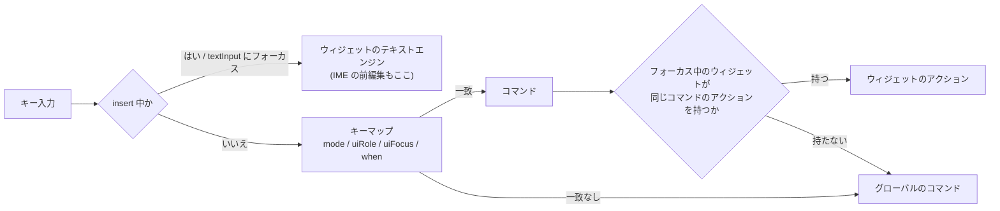
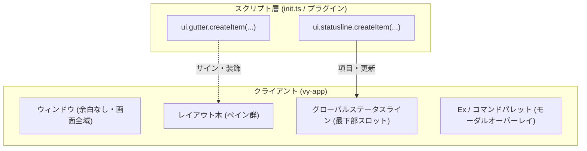

# プラグイン UI

Vy
のプラグインが画面に出すものは、クライアントが描くネイティブのウィジェット木で構成します。Webview
は、Web の文書そのものを表示する場合に限って使います。決定の記録は
[ADR 0005](./adr/0005-native-plugin-ui.md) にあります。

ペインのモデルは [`panes.md`](./panes.md)、API の一覧は
[`api.md`](./api.md)、キーマップの API は [`api.md`](./api.md)
の「コマンドとキーバインド」にあります。

## 1. 方針

1. UI はペインに `ui`
   ビューとして開きます。固定のサイドバーやパネルは作りません。
2. プラグインはウィジェット木を渡します。ウィジェットの配置、描画、フォーカス、キー入力はクライアントが持ちます。
3. プラグインはキーの押下そのものを受け取りません。キーマップがコマンドに解決し、フォーカス中のウィジェットが意味のあるアクションとして受け取ります。文字入力は、フォーカス中のテキスト入力がホストのテキストエンジンで扱います。
4. Webview は最終手段です。Web の文書を表示するときだけ使います。
5. 見た目はテーマのトークンで指定します。生の色やピクセル値は書けません。
6. 固定のヘッダー・フッター・パディングなどの既定 UI
   を排し、スロットを通じて完全にユーザー/スクリプト制御とします（[ADR 0006](./adr/0006-user-controlled-ui-and-slots.md)）。ステータスラインは当面ウィンドウ最下部のグローバルステータスラインとし、標準
   Vim 相当の最小表示を既定とします。

理由は、Vy の中心がモーダル編集だからです。Webview は OS
の入力の持ち主で、キーマップ、モード、カウント、IME
の前編集をクライアントと共有できません。プラグインの UI だけ vim
の操作が効かない、という状態を避けます。

## 2. キー入力の流れ



Phase 1 のエディタでは、クライアントが `EntityInputHandler`
を実装します。前編集の文字列はクライアントが持ち、コアには送りません。確定した文字列だけを
`buffer/did_change`
で送ります。挿入モードの文字入力も同じ経路（`replace_text_in_range`）を通るため、キー入力の処理と文字の挿入が二重になりません。

いま実装しているキーと、これから入れるキーの一覧は [`keymap.md`](./keymap.md)
にあります。

### 2.1 コンテキスト

キーマップの `when` から参照できる値を増やします。`mode` と `paneId`
は既存の値です。

| コンテキスト   | 値                                 | 設定する層   |
| :------------- | :--------------------------------- | :----------- |
| `mode`         | `normal`、`insert`、`select`       | クライアント |
| `viewType`     | `ui`、`editor`、`list` など        | クライアント |
| `paneId`       | フォーカス中のペイン               | クライアント |
| `uiRole`       | `list`、`textInput`、`button` など | UI ホスト    |
| `uiFocus`      | フォーカス中のウィジェットの `id`  | UI ホスト    |
| `webviewFocus` | `true` か `false`                  | UI ホスト    |

```typescript
vy.keymap.bind("normal", "j", "vy.ui.next", { when: "uiRole == 'list'" });
vy.keymap.bind("normal", "r", "example.chat.retry", {
  when: "uiFocus == 'messages'",
});
```

`uiRole` と `uiFocus`
はホストが自動で設定します。プラグインが同じ名前を上書きすることはできません。プラグイン独自の条件は、`keymap.setContext`
で別の名前を足して書きます。

### 2.2 アクションへの解決

フォーカス中のウィジェットは、組み込みのコマンド名に対して自分のアクションを対応づけます。ホストの組み込みコマンドは、対応表にあるアクションを探して実行します。

| 組み込みコマンド | ウィジェットのアクション | 既定のキー            |
| :--------------- | :----------------------- | :-------------------- |
| `vy.ui.next`     | `next`                   | `j`、`Down`、`Ctrl-n` |
| `vy.ui.prev`     | `prev`                   | `k`、`Up`、`Ctrl-p`   |
| `vy.ui.pageDown` | `pageDown`               | `Ctrl-d`              |
| `vy.ui.pageUp`   | `pageUp`                 | `Ctrl-u`              |
| `vy.ui.first`    | `first`                  | `g g`                 |
| `vy.ui.last`     | `last`                   | `G`                   |
| `vy.ui.activate` | `activate`               | `Enter`               |
| `vy.ui.cancel`   | `cancel`                 | `Esc`                 |
| `vy.ui.toggle`   | `toggle`                 | `x`                   |
| `vy.ui.yank`     | `yank`                   | `y`                   |

既定のキーは `uiRole == 'list'`
などの条件付きで登録します。利用者は同じコマンドを別のキーに割り当てられます。プラグインがキーを直接握らないため、操作の意味は変えずにキーだけを変えられます。

ウィジェットが対応を持たないコマンドは、通常のグローバルコマンドとして実行されます。`space`
は既定のアクションに割り当てません。リーダーキーとして使えるようにするためです。一覧の上で
`space f f` を押すと、ファイル検索が開きます。

### 2.3 insert モードの例外

テキスト入力にフォーカスがあり、insert
モードの間は、文字をキーマップに通さずウィジェットのテキストエンジンへ渡します。IME
の前編集も同じ経路です。

次のキーは予約し、テキストエンジンより先にホストが処理します。

| キー               | 動作                                                 |
| :----------------- | :--------------------------------------------------- |
| `Esc`、`Ctrl-[`    | normal モードへ戻る。フォーカスは外さない            |
| `Tab`、`Shift-Tab` | 次のウィジェット、前のウィジェットへフォーカスを移す |
| `Enter`            | 1行の入力では送信。複数行では改行                    |
| `Ctrl-Enter`       | 複数行の入力で送信                                   |

normal モードで `Esc`
を押すと、ウィジェットのフォーカスを外します。外れたあとのキーは、グローバルのキーマップで扱います。ペインのフォーカスはコアが持ち、ペインの中のフォーカスはクライアントが持ちます（[ADR 0003](./adr/0003-editor-state.md)）。

読み取り専用のテキストは、当面は行単位の選択と `y`
によるコピーだけを扱います。文字単位のモーションと選択は段階的に足します。

コマンドパレットと Ex コマンドラインはクライアントのオーバーレイであり、
プラグイン UI のウィジェット木ではありません。入力行、履歴、補完、引数の
プロンプトは共通の仕組みを使います。文法と実行経路は
[`commands.md`](./commands.md) にあります。

## 3. ウィジェット木

プラグインは、状態から木を作る関数を登録します。ホストは前回の木と差分を取り、変わったノードだけを描きます。

```typescript
vy.views.register("example.greeting.view", {
  kind: "ui",
  title: "Greeting",
  render: () =>
    vy.ui.column({ gap: "sm" }, [
      vy.ui.text({ id: "message", text: "こんにちは" }),
      vy.ui.button({
        id: "close",
        label: "閉じる",
        command: "example.greeting.close",
      }),
    ]),
});
```

- 木はクライアントにあります。コアへの往復はありません。データだけを
  `fs`、`workspace`、`backend` から取ります。
- ノードは `id` で識別します。`id`
  が同じノードは、種類が変わらない限り状態を引き継ぎます。
- 高頻度の更新には `ui.update(id, props)`
  を使います。木全体を作り直さずに、そのノードだけを更新します。
- 木の更新はフレーム単位でまとめます。同じフレームに複数の更新が来たときは、最後の値だけを適用します。
- 座標とピクセル値は書けません。大きさは `grow`、`fixed`、`content`
  で指定します。
- 深さ、ノード数、1フレームあたりの更新回数に上限を設けます。超えた場合は
  `ResourceLimit` で失敗させ、プラグインを無効にします。

即時モードにしないのは、QuickJS
をフレームごとに回すコストが読めないためです。木を保持し、差分だけを適用します。

### 3.1 部品

| 分類     | ウィジェット                               | 主な用途                         |
| :------- | :----------------------------------------- | :------------------------------- |
| コンテナ | `column`、`row`、`stack`、`scroll`、`tabs` | 並べる、重ねる、スクロール       |
| テキスト | `text`、`markdown`、`codeBlock`、`label`   | メッセージ、説明、コード         |
| 一覧     | `list`、`tree`、`table`                    | 検索結果、ファイル、会話         |
| 入力     | `textInput`、`checkbox`、`select`          | プロンプト、設定、モデル選択     |
| 表示     | `image`、`progress`、`spinner`、`badge`    | 進捗、状態、添付画像             |
| 操作     | `button`、`iconButton`、`link`、`menu`     | 送信、適用、リンク、文脈メニュー |

- すべての操作要素は `id` を持ち、実行するコマンド ID
  を指定します。ホストはコマンドを実行するだけで、プラグインの関数を直接呼びません。クリックとキー入力を同じ経路に通すためです。
- `menu` と `select`
  のポップアップはホストが描きます。プラグインは位置を指定できません。
- 一覧は単一選択と複数選択を持ちます。選択の状態はウィジェットが持ち、アクションの引数としてプラグインへ渡します。
- `textInput` は1行と複数行を持ちます。フォーカスしたときのモードは
  `insertOnFocus`（プロンプト向き）と `modal`（エディタ向き）から選びます。
- `markdown` と `codeBlock`
  のハイライトはホストが提供します。実装は段階的に足します。

### 3.2 見た目

色、余白、角の丸み、文字の大きさは、テーマのトークン名で指定します。生の RGB
やピクセル値は書けません。テーマを切り替えたときに、プラグインの UI
も一緒に変わるようにするためです。

```typescript
vy.ui.text({
  id: "error",
  text: "接続に失敗しました",
  color: "danger",
  font: "mono",
});
```

プラグインは `theme.register`
でトークンを追加できますが、既存のトークンの意味は変えません。色・余白・フォント・ボタンの見た目は列挙（`ThemeColor`、`Gap`、`Font`、`ButtonVariant`）で、未知の値は
`InvalidParams` で失敗します。

## 4. スロットとユーザー制御 UI

Vy の画面は、クライアントが固定の UI
を押し付けるのではなく、利用者のスクリプト（`init.ts`）やプラグインが完全に制御できるようにします（[ADR 0006](./adr/0006-user-controlled-ui-and-slots.md)）。



### 4.1 クロームの最小化

- **外枠パディングの廃止**:
  ウィンドウ周囲の余計な余白（`p_4`、`gap_2`）を排し、画面全域をエディタおよびペイン木に割り当てます。
- **固定ヘッダー・フッターの廃止**:
  クライアントにハードコードされていたバージョンヘッダーやフッターは存在しません。
- **ペインタイトルの整理**:
  ペイン上部の固定タイトルバーを排し、アクティブペインの境界線ハイライトのみでフォーカスを示します。

### 4.2 グローバルステータスライン

ステータスラインは、ウィンドウ最下部に配置される単一のグローバルステータスラインとします（当面はペイン毎のステータスラインは持たず、グローバルに集約します）。

- スロット項目は `ui.statusline.createItem(options)` で登録・更新します。
- `alignment`（`left`、`center`、`right`）と
  `priority`（並び順）により配置されます。
- スロットに渡せるのはテキスト、色トークン、アイコン名、クリック時のコマンド ID
  です。自由なウィジェット配置はできません（[ADR 0005](./adr/0005-native-plugin-ui.md)）。

### 4.3 標準 Vim スタイルの既定表示

ユーザーが何も設定しなくても、標準の Vim
に準拠した必要最小限のステータスライン項目をデフォルトで提供します：

| 位置   | 項目         | 例                             | 説明                           |
| :----- | :----------- | :----------------------------- | :----------------------------- |
| **左** | モード       | `NORMAL` / `INSERT` / `SELECT` | 現在のアクティブペインのモード |
| **左** | ファイル名   | `src/main.rs`                  | 相対パスまたはファイル名       |
| **左** | 変更状態     | `[+]`                          | 未保存の変更がある場合に表示   |
| **右** | カーソル位置 | `12:45`                        | 行番号:列番号（1 始まり）      |
| **右** | 進捗         | `Top` / `54%` / `Bot`          | 文書全体のスクロール位置       |

これらの既定項目もスロットアイテムとして登録されるため、利用者は `init.ts`
で不要な項目を `dispose()`
したり、独自のフォーマットに置き換えることができます。

### 4.4 その他のスロット

ステータスラインのほかに、以下のスロットを段階的に実装します：

- `ui.gutter`: 行番号の横にブレークポイントや Git 変更マーク、診断サインを表示
- `ui.picker`: ファイル一覧やコマンドパレットの候補選択
- `ui.hover`: カーソル下のシンボル情報や型情報のポップアップ

## 5. 状態と復元

- `views.register` の `options`
  には、`kind`、`title`、`singleton`、`preferredSize`、`render`、`actions`、`restore`
  を指定します。
- ペインは `params` と `state` を持ちます。どちらもプラグインが決めた JSON
  で、コアがレイアウト木と一緒に保存します。
- `state` は `ui.setState(paneId, state)`
  で更新します。会話の履歴のように、開き直しても残したい値だけを入れます。
- `params` と `state` は `layout/get` で返し、`layout/did_change`
  には含めません。木の描画には要らず、復元と再描画にだけ必要だからです。
- 復元では、コアが `params` と `state` を返し、プラグインの `restore`
  が状態を戻します。そのあと `render`
  が木を作ります。木そのものは保存しません。バージョンが変わっても壊れないようにするためです。
- スクロール位置とフォーカスの履歴は、クライアントが `session.json`
  に保存します。表示だけの状態のためです（[ADR 0003](./adr/0003-editor-state.md)）。
- 復元に失敗した場合は、そのペインを空のエディタにします。レイアウト木は壊しません。

## 6. Webview の位置づけ

Webview は、Web の文書そのものを表示するときだけ使います。

| 使ってよい例                           | 使わない例                         |
| :------------------------------------- | :--------------------------------- |
| Notebook のセル出力                    | チャット、問い合わせフォーム       |
| HTML と Markdown のプレビュー          | ファイル一覧、検索結果、ピッカー   |
| 外部サービスの埋め込み（地図、グラフ） | 設定画面、確認ダイアログ、メニュー |

判断の目安は、コンテンツが Web の文書か、操作が編集の一部か、です。操作を伴う UI
は `ui` ビューで作ります。

Webview を使う場合の規則は次のとおりです。

- 外側のフォーカス、フォーカス枠、`Esc` での離脱はホストが持ちます。
- OS によっては、Webview が `Esc`
  を先に受け取ります。その場合は、フォーカス枠の外側をクリックするか、ホストのコマンドでフォーカスを移します。
- Webview の中のキーバインドは保証しません。vim の操作を Webview
  の中で再現しません。
- 必要な操作は、ホスト側のボタンかコマンドとして外に出します。
- テーマのトークンは、ホストが CSS 変数として注入します。
- Webview
  からホストへ未処理のキーを転送する仕組みは、必要になったときに足します。転送できても、モードとカウントの一致は保証しません。

## 7. 例: AI チャット

チャットは、縦に並ぶメッセージの一覧と、1つの入力で足ります。Webview
は不要です。

```typescript
let messages: Message[] = [];

vy.views.register("example.chat.view", {
  kind: "ui",
  title: "Chat",
  singleton: true,
  restore: (_params, state) => {
    messages = state?.messages ?? [];
  },
  render: () =>
    vy.ui.column({ gap: "sm" }, [
      vy.ui.scroll(
        { id: "messages", grow: 1 },
        messages.map((m) => vy.ui.markdown({ id: m.id, text: m.text })),
      ),
      vy.ui.row({ gap: "sm" }, [
        vy.ui.textInput({
          id: "prompt",
          grow: 1,
          multiline: true,
          mode: "insertOnFocus",
          placeholder: "質問を入力",
        }),
        vy.ui.button({
          id: "send",
          label: "送信",
          command: "example.chat.send",
        }),
      ]),
    ]),
  actions: {
    next: "example.chat.nextMessage",
    prev: "example.chat.prevMessage",
    yank: "example.chat.copy",
  },
});

vy.commands.registerCommand("example.chat.send", async () => {
  // 送信し、応答のチャンクごとに ui.update を呼ぶ
});

await vy.panes.open({
  view: "example.chat.view",
  placement: {
    target: await vy.panes.activePane(),
    direction: "right",
    ratio: 0.35,
  },
});
```

- 送信はボタン、`Ctrl-Enter`、`commands.execute`
  のどれでも同じコマンドに入ります。
- `actions` の各コマンドは、プラグインが `commands.registerCommand`
  で登録します。
- 応答のストリームは、`backend`
  のチャネルから受け取り、`ui.update(messageId, { text })`
  で該当のメッセージだけを更新します。
- メッセージの上で `j` と `k` を押すと、`vy.ui.next` と `vy.ui.prev`
  が一覧の選択を動かします。`y` はコピー、`Esc` はフォーカスを外します。
- コードをエディタへ挿入するときは、`editor.selections()` を見て `editor.edit`
  を呼びます。
- 会話の履歴は `state`
  に入れます。ウィンドウを閉じて開き直しても、同じ会話に戻れます。

## 8. 制約

- 任意のピクセル描画はできません。グラフ、地図、複雑な可視化は画像にするか、Webview
  を使います。
- React などの UI フレームワークは動きません。状態管理はプラグインの JS
  で行い、描画は木で指定します。
- ペインの外にはみ出すオーバーレイは、ホストが描くもの（`menu`、`select`、通知、ピッカー）に限ります。
- ウィジェットの追加はホストの仕事です。プラグインは既存の部品を組み合わせます。

## 9. アクセシビリティとフォーカス管理

キーボードのみでの操作、フォーカスの移動順序、およびスクリーンリーダー等の支援技術への対応方針です。

### 9.1 フォーカスの移動順序とキーボード操作

- **ペイン間の移動**:
  - `Ctrl-w h` / `j` / `k` / `l`:
    幾何学的な方向（左・下・上・右）に基づき隣接するペインへフォーカスを移動します。
  - `Ctrl-w w`:
    レイアウト木を深さ優先探索（DFS、左上から右下）の順序で巡回移動します。
  - マウス操作を行わずにすべてのペインとウィジェットへフォーカスを移動できます。
- **UI ウィジェット内の移動**:
  - リスト / ツリービュー: `j` / `k`（または矢印キー `Down` /
    `Up`）で項目を移動します。
  - 入力欄（`textInput`）: フォーカス時は直接入力。`Tab` / `Shift-Tab`
    で次の入力可能要素へ移動します。

### 9.2 Esc のフォーカス層（Esc Layering）

複数の状態（モーダル、モード、ペイン）が重なった際の `Esc`
の優先順位を以下のように層（Layer）として定義します:

1. **第 1 層（最前面モーダル）**: コマンドパレット、Ex
   コマンドライン、プラグイン承認ダイアログなどのモーダルオーバーレイが開いている場合、`Esc`
   はオーバーレイを閉じ、直前のフォーカス元へ戻します。
2. **第 2 層（エディタモード）**: エディタペインが `Insert` モードまたは
   `Select` 系モードの場合、`Esc` は `Normal` モードへ戻り、選択を 1
   文字（または直前文字）へ縮小します。
3. **第 3 層（カスタム UI / サイドペイン）**: `Normal` モードでカスタム UI
   ビュー（ツリービューやサイドペイン）にフォーカスがある場合、`Esc`
   はアクティブな最後のエディタペインへフォーカスを戻します。
4. **第 4 層（Normal エディタ）**: `Normal`
   モードのエディタペインでは、ホバーポップアップ等のトランスジェント表示があれば閉じ、それ以外は
   `Esc` は何もしません。

### 9.3 読み上げとセマンティクス

- GPUI
  の要素木が提供するアクセシビリティセマンティクス（ラベル、ロール、値）を活用し、OS
  ネイティブの支援技術（macOS NSAccessibility、Linux AT-SPI）と連携します。
- ステータスラインや通知（`notifications.show`）のメッセージは、状態行の更新時にアクセシビリティアナウンス（live
  region 相当）として通知できるようにします。

## 10. 未決定事項

- ペイン毎ステータスラインのサポート時期と、グローバルステータスラインとの切り替え設定（`ui.statusline.mode: "global" | "per-pane" | "none"`）。
- ステータスライン項目のクリック時のコマンド実行処理とコンテキスト渡し。
- カウント（`5j`）をキーマップからアクションへ渡す方法。キーマップ側で数字を解釈する必要があります。
- 読み取り専用テキストに対するモーションと選択の範囲。当面は行単位の `y`
  から始めます。
- `textInput` のフォーカス時の既定モードを `insertOnFocus` にするか、`modal`
  にするか。
- `modal` の `textInput`
  を、エディタと同じバッファ、モーション、アンドゥで動かすか。単純な入力欄に留めるか。
- 既存の `list` と `text` ビューを、`ui`
  ビューのプリセットに寄せるか。当面はコア提供のビューとして残す。
- `markdown` と `codeBlock`
  のハイライトをクライアントで計算するか、コアに問い合わせるか。
- ストリーミング中の長い Markdown
  を、毎フレーム再パースしない方法（差分パース、末尾のブロックだけの更新など）。
- ウィジェット木の上限（深さ、ノード数、更新頻度）の値。
- プラグインが合成ウィジェットを定義できるようにするか。
- Webview からのキー転送をどこまで保証するか。
