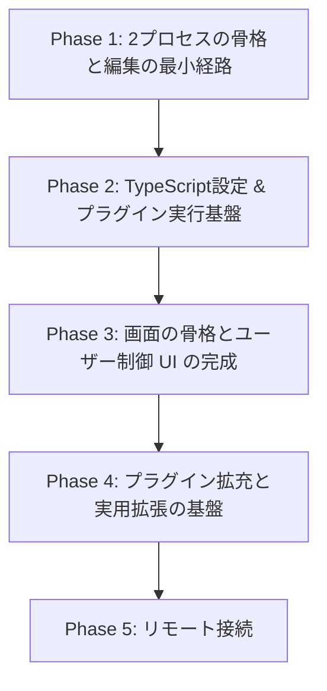

# [Worklog] Phase 1〜5 実装進捗ログ

エディタの基本骨格からリモート接続までの初期実装フェーズ（Phase 1〜5）の実施内容と検証結果の記録です。

---

## 1. Phase 1: 2プロセスの骨格と編集の最小経路

- [x] `crates/vy-app`、`crates/vy-server`、`crates/vy-proto`、`crates/vy-core` の雛形作成
- [x] クライアントが `vy-server` を子プロセスで起動し、標準入出力でフレームを読み書き
- [x] `initialize` と `initialized` のハンドシェイク
- [x] `pane/open` で文書を開き、`buffer/snapshot` で本文を受け取って描画
- [x] `ropey` によるテキストバッファと、`buffer/did_change` のサーバー側の適用
- [x] クライアントからの `buffer/did_change` 送信と `buffer/resync` 反映
- [x] Helix 方式のモーダル入力エンジン（Normal, Insert, Select モード、`Selection -> Action`）
- [x] カウント（`5j`, `5x`）、`"a`–`"z` レジスタ、`p` / `P`、`.` の繰り返し
- [x] 日本語 IME の前編集（`EntityInputHandler`）

### 検証項目
- Linux (Wayland) で起動確認。
- 日本語 IME の前編集がカーソル位置に描画されることを確認。
- 20万行ファイルの読み込みとスクロール実測: スナップショット 7.2 ms、1 フレームの組み立て 0.1–0.4 ms。
- `vy-server` 終了時にクライアントが落ちずに通知を出すことを確認。

---

## 2. Phase 2: TypeScript設定 & プラグイン実行基盤

- [x] `rquickjs` をクライアントに統合し、ジョブキューを処理
- [x] `~/.config/vy/init.ts` と `settings.json` の読み込みと 4 層解決（既定値、ユーザー、プロジェクト、メモリ）
- [x] プラグイン API シムと Rust 型からの型生成（Specta への集約: ADR 0023）
- [x] プラグイン API をグローバル `vy` に統一（ADR 0019）
- [x] `init.ts` およびソース形態プラグインの相対 TypeScript import 実装（ADR 0020）
- [x] コマンドとキーバインド登録（`commands.registerCommand`, `keymap.bind`）
- [x] `y` / `Y`、演算子 `d` / `y`、テキストオブジェクト、行単位レジスタ、単語クラス
- [x] ケイパビリティのパース、glob 照合、`trusted.json` の読み書き（`vy-capabilities`）

---

## 3. Phase 3: 画面の骨格とユーザー制御 UI の完成

- [x] レイアウト木（分割、フォーカス移動、比率の動的変更 `pane/resize`）
- [x] マルチバッファ（同一バッファを複数ペインで開き、ペインごとにカーソル・選択・スクロール・モードを保持）
- [x] `editor.open` (`:e`), `document.save` (`:w`)
- [x] ペイン組み込みコマンド（`:vsp`, `:sp`, `:q`, フォーカス移動）
- [x] 文書切り替え（`:b`, `:buffer`, ドキュメントピッカーモーダル）
- [x] `views.register` と `ui` 名前空間によるウィジェット木（column, row, stack, text, button, textInput 等）
- [x] ユーザー制御 UI とスロット（ADR 0006: ステータスライン、ピッカー、ガター、ホバー）
- [x] コマンドパレット（`Space` リーダー）、Ex コマンドライン（`:`）

---

## 4. Phase 4: プラグイン拡充と実用拡張の基盤

- [x] 外部プラグインのマニフェスト読み込みと対話的承認 UI（`trusted.json`）
- [x] `activationEvents` による遅延読み込み（`onView:xxx`, `onCommand:xxx`）
- [x] エディタ・ワークスペースイベント通知 API（`onDidChangeSelection`, `onDidChangeActiveEditor` 等）
- [x] プロセス実行とファイルシステムアクセス API（`fs.*`, `process.*`）
- [x] プラグインごとの QuickJS ランタイム分離
- [x] バンドル形態のロード時検証（残存 import、サイズ、SHA-256: ADR 0021）
- [x] 実用プラグイン検証: `nvim-tree` 相当のファイラーペインの実装・動作検証

---

## 5. Phase 5: リモート接続

- [x] Transport をローカルと SSH で切り替え可能に実装
- [x] `connections.json` と `vy-app --connect <name>` の追加
- [x] SSH 経由でリモートの `vy-server` を起動
- [x] ワークスペースごとのレイアウト・開いている文書のコア側保存
- [x] 再接続と再同期（`layout/get`, `sync/request`, バージョン照合）
- [x] 未保存の本文をクライアントから復元

